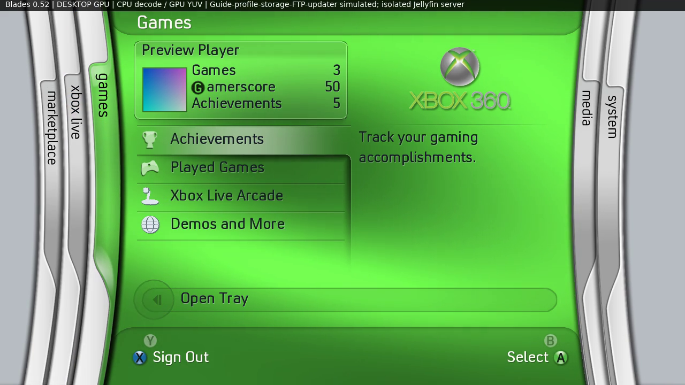

# Blades Reimagined

**The classic Xbox 360 Blades interface, recreated as a homebrew dashboard for the Xbox 360.**

Blades Reimagined brings back the curved tabs, sliding menus, animated backgrounds
and sounds of the original dashboard, with tools for launching games and homebrew,
playing videos, browsing Jellyfin and transferring files over FTP. The aim is to
make the Blades experience useful on a console today while getting its appearance
and movement as close to the original as possible.

It runs as a standalone app named **Blades** alongside your existing setup. It
uses your installed Xbox kernel and Guide for account actions; installing it does
not flash an older dashboard or change your default launcher.

**Current build: v0.52** ·
[Download the complete USB ZIP](https://raw.githubusercontent.com/sbayfield09/Blades-reimagined/224eb37feaa31c82dee46e3007d0f9a0977250a2/dist/Blades-v0.52-USB.zip) ·
[Watch the walkthrough](https://raw.githubusercontent.com/sbayfield09/Blades-reimagined/224eb37feaa31c82dee46e3007d0f9a0977250a2/dist/Blades-v0.52-walkthrough.mp4) ·
[Release notes](docs/RELEASE-0.52.md)



*Desktop preview from v0.52 using the shared dashboard renderer. Profile/Guide,
storage, FTP and update/restart scenes in the walkthrough are simulated; the
capture is not footage from an Xbox.*

## What can it do?

| Area | Features |
| --- | --- |
| Classic interface | Five blades—Marketplace, Xbox Live, Games, Media and System—with startup/menu animations, moving backgrounds, selection effects and navigation sounds. |
| Games and homebrew | Scan folders you choose, adjust scan depth and launch supported extracted games, Arcade/Games on Demand packages, apps and homebrew. |
| Disc drive | Open/close the tray, show reading/game-title states and launch game discs manually. Games do not launch automatically on insertion. |
| Profiles and achievements | Show account information, gamer picture and gamerscore; browse achievements and open the Xbox Guide for sign-in, profile and achievement actions. |
| File browser | Browse HDD/USB files and launch supported loose `.xex` executables without adding a scan folder. |
| Local video | Play the selected file inside Blades, with pause/resume, seeking and fit/stretch controls. Format support and performance depend on the file. |
| Jellyfin | Browse movies and series with artwork, descriptions and runtimes; use Continue Watching, Next Up, resume and seeking. The server supplies a compatible transcoded stream. |
| FTP | Transfer files between your computer and console while Blades is open. View connection details, change the login or turn the server off. |
| Updates | Check this repository for a newer build, download and verify it, then install and restart using the bundled installer helper. |

This is a work in progress. The familiar menu layout includes items whose
original services are not implemented yet; see [Current limitations](#current-limitations).

## What do I need?

- **An Xbox 360 that can launch unsigned homebrew XEX files**, using an existing
  RGH/JTAG or compatible Peer Pressure setup. An unmodified retail console cannot
  launch this app.
- A controller and HDD or USB storage that your console can already read.
- The **complete USB ZIP** linked above. Artwork and the installer helper are
  included; no font download, artwork conversion or separate video player is needed.

Games and personal media are not included. Local use does not require a network
connection. FTP and Jellyfin use your network; checking/downloading updates
requires internet access. No DashLaunch plugin is required by Blades.

## Install and launch

1. Download the **complete v0.52 USB ZIP** above and extract it on your computer.
2. Copy the whole `Blades` folder to your console's HDD or a USB drive.
3. Keep the folder together, including `Assets` and `update-installer.xex`.
4. Open your existing homebrew launcher/file browser, such as Aurora, and launch
   `Blades/default.xex`.

The important files look like this:

```text
Blades/
  default.xex             # Launch this
  update-installer.xex    # Required for automatic updates
  Assets/                # Premade artwork and other resources
  Config/                # Your settings are saved here
  licenses/
  README.txt
```

For an existing installation, keep your saved `Config` files when copying the
new package. Blades runs as an app, so you can keep your current launcher and
return to the system dashboard through the exit menu. Installing it does not
register it as your default dashboard.

## Getting started

- **Add games/apps/homebrew:** open **Games → Played Games → Scan Folders**,
  choose **Add Folder**, browse to a location and press **X: Use Folder**. Choose
  its category and scan depth. Your entries appear in Game Library, Apps or
  Homebrew. [Library and supported package formats](docs/LIBRARY.md).
- **Browse files directly:** open **Games → Played Games → File Manager**.
  All file types are visible; supported `.xex` files can be launched with A.
  X refreshes the folder. This browser does not copy, delete or edit files.
- **Add local media:** manage scan folders under **Media → Video Marketplace**.
  New media paths are shared and filtered by file type. Videos appear under
  **Media → Video → Local**. Music and Pictures browsing exists, but playback
  for those two apps is unfinished. [Video playback](docs/VIDEO-PLAYBACK.md).
- **Connect Jellyfin:** open **Media → Media Center**, enter the server's LAN
  IPv4 address/port and your Jellyfin login, then select Connect. Browse through
  **Media → Video → Jellyfin**. The account needs permission to transcode.
  [Connection setup and limits](docs/JELLYFIN.md).
- **Transfer files:** open **System → Computers** for the FTP status, console IP
  and login controls. FTP starts enabled by default, on port **21**, with
  **`blades` / `blades`** as the initial username/password. Use plain FTP in your
  client. You can change the login or disable the server in that menu; it keeps
  running across blades while the app is open. [FTP guide](docs/FTP.md).

### Controller basics

| Button | Action |
| --- | --- |
| D-pad / left stick | Move through menus |
| LB / RB or Left / Right | Switch blades outside playback |
| A / B | Select / go back |
| X / Y | Context action shown on screen, such as refresh, sign out or eject |
| Back | Open the exit menu outside playback |

During video playback: **A** pauses/resumes, **Left/Right** seeks, **X** toggles
fit/stretch and **B** returns to the video list.

## Updating

In v0.52 and later, open **System → Update Blades → Update and Restart** when a
newer version is available. Blades downloads and verifies the package, prepares
the files, closes the running app, installs the update and relaunches. Settings
are preserved, with backups and a journal for recovery from interrupted copying.
Keep the storage device connected until it finishes.

**If you have v0.50 or v0.51, install the complete v0.52 ZIP manually once.**
Those versions only download ZIPs and cannot install the new updater behavior
for themselves. Keep `update-installer.xex` beside `default.xex` for future updates.
See [how updates and recovery work](docs/UPDATES.md).

## Current limitations

- Music/Pictures playback and the original music visualisations are unfinished.
- Many stock Marketplace, social and system-settings menus remain placeholders.
  The Xbox Live blade does not recreate Microsoft's original online services.
- Visual fidelity, video performance and hardware compatibility are still being
  refined. Not every stock-dashboard behavior has been reproduced.
- The dashboard has been tested on real Xbox 360 hardware during development.
  The new **v0.52 automatic installer/native restart path still needs console
  verification**; its download, file installation and rollback tests pass on the
  desktop. Desktop captures do not establish console performance or power-loss
  durability. [Validation details](docs/VALIDATION.md).

If something goes wrong, open an [issue](https://github.com/sbayfield09/Blades-reimagined/issues)
with the Blades version, console/kernel and launch setup, steps to reproduce,
and a screenshot or relevant part of `default.log` beside the XEX. Remove private
server addresses, account/session details and other personal information before
sharing logs.

## Source and development

Application source is available in [`src`](src), [`include`](include) and
[`tests`](tests). The [complete v0.52 source bundle](https://raw.githubusercontent.com/sbayfield09/Blades-reimagined/224eb37feaa31c82dee46e3007d0f9a0977250a2/dist/Blades-v0.52-source.zip)
also includes dependency sources and a pinned open-source SDK. A Linux/SDL3
preview is available for development; you do not need it to use the Xbox build.

- [Build and relink instructions](docs/BUILDING-SOURCE.txt)
- [SDK/API notes](docs/SDK-AUDIT.md) and [toolchain provenance](docs/TOOLCHAIN.md)
- [Xbox testing notes](docs/CONSOLE-TEST.txt)
- [All downloads and older builds](dist/)

## Credits and licensing

Built with the open-source [xsdk](https://github.com/xenosworks/xsdk). Artwork
adaptation and the animated background draw on
[DashX360](https://github.com/ZivvoZ/dashx360); video playback uses FFmpeg and
ported [Simple360Player](https://github.com/HG-ERIK/simple360player) code. Jellyfin
integration builds on XenonFin. Attribution and source provenance are retained
in the documentation, source bundle and runtime `licenses` folder.

The combined dashboard executable is distributed under **GNU GPLv3**. Original
project code retains its MIT notices; dependencies, fonts and artwork retain
their respective licences and ownership. See [GPLv3](COPYING.GPLv3), the original
[MIT licence](LICENSE) and [distribution notices](docs/VIDEO-LICENSE-NOTICE.txt).
No Microsoft XDK is required to build the project.

Xbox and its associated artwork, names and trademarks belong to their respective
owners. This is an independent fan project, unaffiliated with Microsoft.
