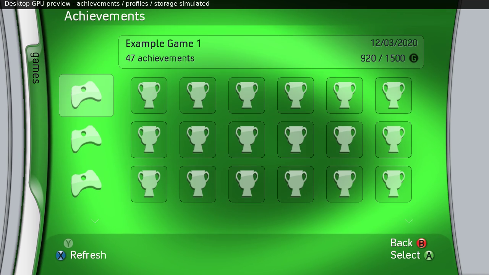
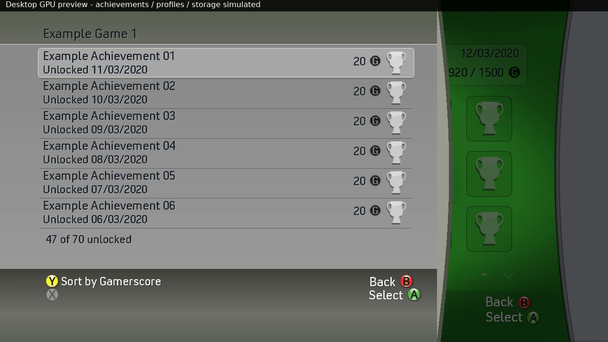
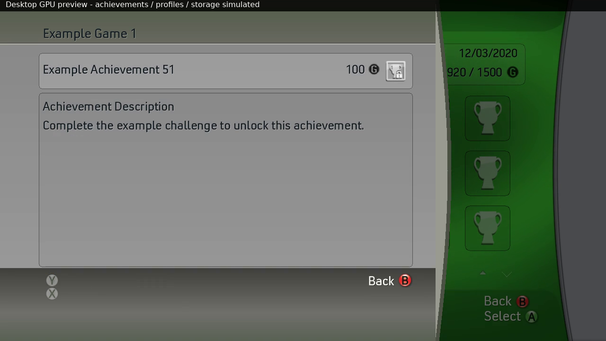

# Achievements — 0.27

Games → Achievements opens a profile-backed browser. When signed out it first
requests XamShowSigninUI(1,0), the real Xbox Guide sign-in menu. After successful
sign-in it resumes the browser; cancellation leaves the dashboard. The active
controller account is captured and revalidated before/after metadata work.
Changing accounts closes the browser and clears prior account data.

The supplied Forza Horizon photo establishes the three-game icon strip, title
summary, earned/possible gamerscore and six-by-three icon grid. The newly
uploaded 22-minute video confirms the green page shows unlocked achievements:
near 05:20 GTA V has two icons for two unlocked achievements; around 05:25 FIFA
11 has four icons for four unlocks. Around 04:30–04:45 it shows the gray list,
score sorting, unlock dates and Achievement Description. Those actual frames
were inspected before finalizing this implementation. The generic Games home
images used earlier were not achievement-menu references.

Controls:

- Up/Down in the left strip select a played game; its history is ordered by
  last played. A opens the all-achievement list. Right enters the earned grid.
- Arrows move within the six-column grid; it pages in groups of 18. A opens a
  selected achievement description. Left from the first column returns to games.
- The gray list shows six rows with labels, status, dates, score and pictures.
  Up/Down scroll; Y switches recent/gamerscore order; A opens the description.
- B returns one level through descriptions, lists/grid, games and dashboard.
- X refreshes the green browser. It does not perform profile sign-out in this
  submenu. The library and root profile shortcuts keep their existing functions.

These gray views are in-app Guide-style read-only panels, based on the video.
The sign-in picker is the actual system Guide. Native account authentication
is never reimplemented by the preview or the achievement browser.

The Xbox adapter optionally resolves XamUserCreateTitlesPlayedEnumerator
(755), XamUserCreateAchievementEnumerator (750), and XamReadTileToTexture (757).
Enumeration uses a zero requestee XUID to select the current local user slot,
including offline accounts. The captured nonzero account XUID is used only for
identity validation and cancellation. Enumeration results use bounded big-endian
168-byte title records and 36-byte achievement records with checked UTF-16
string pointers. FILETIME is decoded as low/high DWORDs with BE bytes inside
each DWORD. Names, achievement/score totals, dates and flags come from XAM.
Unsupported title marks follow the existing question-mark cleanup preference.
Unlocked flags include offline/online unlocks. Secret locked names/descriptions
stay hidden; unlocked descriptions become available normally.

Pictures are requested through the console's cached tile reader (game type 1,
achievement type 0). No per-game achievement artwork is shipped in the pack,
and there is no separate Internet scraping/downloader. Games, profile GPDs
and the system cache normally supply definitions/pictures; uncached artwork can
be unavailable. The original pack's controller/trophy, unearnedAchievement.png,
secretAchievement.png, scroll.png and GScore.png supply fallbacks/UI artwork.
The 234-entry payload is unchanged. Real user pictures/history remain in RAM.

Metadata work and image reads run off the render thread, with bounded counts
and cancellation between XAM operations. Empty results complete normally.
Accounts are checked again before publishing; results from retired requests
are discarded. Memory is bounded to 1024 history titles and 512 achievements
per title. A limit message appears rather than silently implying a complete
larger list. Missing definitions are not turned into fictional achievement data.
Dates currently use the stored FILETIME converted to a day/month/year UTC date.
No profile files, progress, achievement flags or gamerscore are written.

Validation includes shared parser/navigation/worker tests and a host fixture
that compiles the actual Xbox adapter against the pinned SDK declarations.
Fixtures verify local-requestee mode, optional ordinals, parameters, title/entry
sizes, checked strings, pictures, sorting, empty/error completion and handle
cleanup. Memory sanitizer checks cover both test programs. CPU/GPU comparisons
cover loading, missing/empty data, the grid, paging, lists, sorting, descriptions,
secret entries, profile cards and the earlier dashboard features. They do not
prove the real console APIs return the expected profile data. Please verify
those reads, cached pictures and sign-in continuation on a physical Xbox 360.

The matching walkthrough clearly labels its profile/history/progress/artwork
and storage data as desktop simulations. Its example counts are not present in
the native adapter. See WALKTHROUGH.md for times and the data audit for hashes.

Desktop preview captures from this release (all data explicitly simulated):

