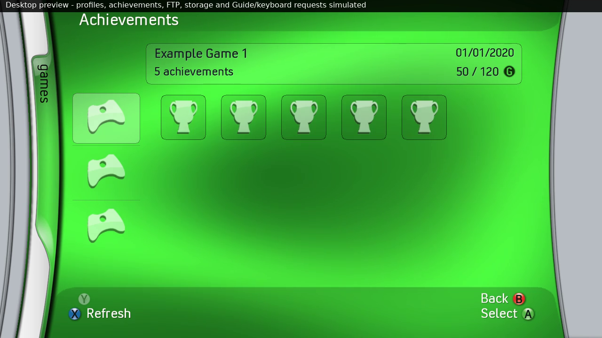

# Achievements — 0.31

Games → Achievements opens a profile-backed browser. When signed out it first
requests XamShowSigninUI(1,0), the real Xbox Guide sign-in menu. After successful
sign-in it resumes the browser; cancellation leaves the dashboard. The active
controller account is captured and revalidated before/after metadata work.
Changing accounts closes the browser and clears prior account data.

The supplied Forza Horizon photo establishes the three-game icon strip, title
summary, earned/possible gamerscore and six-by-three icon grid. The newly
uploaded 22-minute video confirms the green page shows unlocked achievements:
near 05:20 GTA V has two icons for two unlocked achievements; around 05:25 FIFA
11 has four icons for four unlocks. Around 04:30–04:45 it shows the gray list,
score sorting, unlock dates and Achievement Description. Those actual frames
were inspected before finalizing this implementation. The generic Games home
images used earlier were not achievement-menu references.

Controls:

- Up/Down in the left strip select a played game, ordered by last played.
  A opens that game's achievements in the real Xbox Guide. Right enters the grid.
- Arrows move within the six-column earned grid, paging in groups of 18.
  A opens the selected achievement in the real Xbox Guide, using its actual ID.
  Left from the first column returns to the game strip.
- The Guide handles its own achievement list, descriptions and controls.
  Closing it returns to the same green page, game and icon selection.
- B leaves the grid for the game strip, then returns to Games.
- X refreshes the green browser. Y retains ordinary disc eject here.

Version 0.28 removes the in-app gray list/description panels. Native Guide
requests run on the main thread and use XamShowAchievementsUI (ordinal 709,
user slot and game Title ID) or XamShowAchievementDetailsUI (ordinal 736,
user slot, game Title ID and achievement ID). The selected profile identity is
checked again before calling. Blades keeps presenting and blocks its own input
while the Guide is active; closing it rearms input and refreshes cached pictures.
Unavailable exports or rejected requests show an error rather than substituting
a custom achievement menu.

The signatures were checked against the original retail 5766 dash.xex from
[the referenced archive](https://github.com/thedev0ps/Xbox-360-Dashboard-Archive/tree/0938397d60975630db108fded069bc04d52740b1/Blades/Retail/5766).
Its SHA-256 is 8ac65275d67fe8f5447276bfc606f796a76a1c20f68b097bc126dfeed6618f4b.
At 0x92213754, the call to ordinal 736's thunk (0x92705d34) supplies r3=user,
r4=Title ID, r5=achievement ID. At 0x922137d0, ordinal 709's thunk
(0x92705304) receives r3=user and r4=Title ID. Xenia Canary's public
XamShowAchievementsUI implementation also confirms the two-argument game view.
No stock executable or decoded dashboard image is included in this release.

The game strip now has a thin dividing line between each pair of visible game
icons, matching the supplied photo and uploaded video near 05:20. A translucent
dark line with a faint lower highlight reproduces the reference's beveled edge.

The Xbox adapter optionally resolves XamUserCreateTitlesPlayedEnumerator
(755), XamUserCreateAchievementEnumerator (750), and XamReadTileToTexture (757).
Enumeration uses a zero requestee XUID to select the current local user slot,
including offline accounts. The captured nonzero account XUID is used only for
identity validation and cancellation. Enumeration results use bounded big-endian
168-byte title records and 36-byte achievement records with checked UTF-16
string pointers. FILETIME is decoded as low/high DWORDs with BE bytes inside
each DWORD. Names, achievement/score totals, dates and flags come from XAM.
Unsupported title marks follow the existing question-mark cleanup preference.
Unlocked flags include offline/online unlocks. Secret locked names/descriptions
stay hidden; unlocked descriptions become available normally.

Pictures are requested through the console's cached tile reader (game type 1,
achievement type 0). No per-game achievement artwork is shipped in the pack,
and there is no separate Internet scraping/downloader. Games, profile GPDs
and the system cache normally supply definitions/pictures; uncached artwork can
be unavailable. The original pack's controller/trophy, unearnedAchievement.png,
secretAchievement.png, scroll.png and GScore.png supply fallbacks/UI artwork.
The 234-entry payload is unchanged. Real user pictures/history remain in RAM.

Metadata work and image reads run off the render thread, with bounded counts
and cancellation between XAM operations. Empty results complete normally.
Accounts are checked again before publishing; results from retired requests
are discarded. Memory is bounded to 1024 history titles and 512 achievements
per title. A limit message appears rather than silently implying a complete
larger list. Missing definitions are not turned into fictional achievement data.
Dates currently use the stored FILETIME converted to a day/month/year UTC date.
No profile files, progress, achievement flags or gamerscore are written.

Validation includes shared parser/navigation/worker tests and a host fixture
that compiles the actual Xbox adapter against the pinned SDK declarations.
Fixtures check the selected user, Title ID and actual achievement ID, Guide
return codes, busy/stale-profile guards and absent-export errors, as well as
local metadata parsing, pictures, empty/error completion and handle cleanup.
Both fixtures pass ASan/UBSan/LSan. CPU/GPU comparisons cover the green grid,
paging, game separators, loading/empty/error data and prior dashboard features.
These checks do not execute the native Guide. Please verify opening an exact
achievement, returning to the same selection, and account changes on a 360.

The fresh walkthrough labels profile/history/progress/artwork and storage as
desktop simulations. On A it shows an explicit Guide-request notice; it cannot
capture the actual console Guide. See WALKTHROUGH.md and the release data audit.

Desktop preview from this release (all profile/achievement data simulated):

Version 0.31 corrects the unlock-bit mask to 0x00030000: 0x00010000 is an
online unlock and 0x00020000 an earned achievement. The prior 0x30000000 mask
mistook real earned records for locked ones, producing the user's Blur case:
5 achievements / 50 gamerscore in the title header but an empty earned grid.
Fixtures now cover both real low-bit flags and reject the old high-bit mask.
The public Xenia Canary gpd_info.h / AchievementFlags definitions corroborate
these values. This changes only decoding/display, never achievement progress.

The existing game-icon size, 116-pixel row pitch, header and grid positions
are retained. Only the game-strip selection box is adjusted: its top moves
from row_y-8 to row_y-4 and its height becomes 108, leaving space below the
preceding divider and above the following one. The 88-pixel game artwork stays
at x182 / row_y+4; no icon rescaling or re-spacing is introduced.
