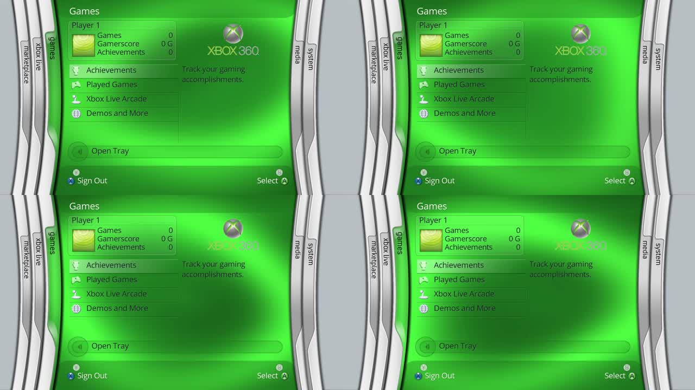

# Supplied background animation, 0.7.0

Version 0.7.0 reuses the animated surface implementation from the DashX360
repository supplied by the user. It keeps the same 384x216 texture, moving
band, drift, lighting equations, timing and blade tint values.

Source: [BladeAmbientTexture.cs](https://github.com/ZivvoZ/dashx360/blob/0c8adb2cef4ad7dff2bf889351efa1f1c244aef2/XboxMetroLauncher/XboxMetroLauncher.Controls/BladeAmbientTexture.cs)
and [BladeCenterHost.cs](https://github.com/ZivvoZ/dashx360/blob/0c8adb2cef4ad7dff2bf889351efa1f1c244aef2/XboxMetroLauncher/XboxMetroLauncher.Controls/BladeCenterHost.cs).

The supplied reference-image ZIP contains stills. The inspected shared 5766
archive contains icons/logos and other shared resources, without a background
animation clip. DashX360's background is generated by this code; its video
assets are boot sequences. Its MC360 haze images are static edge overlays.
Consequently this release ports the supplied animation implementation, rather
than claiming to play an original Microsoft animation file. The encrypted
main dashboard resources have not been decoded.

## Rendering

`src/render/ambient.c` evaluates the supplied moving light/ribbon field at
30 Hz, then tints and smoothly scales it to 1280x720. Root menus, expanded
submenus and blade transitions all use the dashboard's shared elapsed clock.
Changing blades changes the tint without restarting motion. The surface
continues beneath the active tab, translucent chrome, header and footer using
the existing BSK2 shell boundaries.

Lookup tables accelerate the supplied sine/exponential expressions, and an
angle-addition identity avoids per-pixel trigonometric calls for one lighting
term. A shared field cache avoids recalculating motion for both sides of a
blade transition. Its allocation is about 1 MiB; allocation failure uses a
plain blade colour. The old five cached full-size static backgrounds are
removed. The animated surface is evaluated continuously; no short video loop
or phase reset is used.

The artwork pack keeps all 195 entries and identical BSK2 geometry. Twenty-five
header/footer/tray images are retinted to the supplied background palette.
Use the matching 0.7 XEX and premade artwork pack together.

## Verification

- Five CTest suites pass: dashboard, resources, skin, ambient and SDL smoke.
- Independent samples of the supplied C# equations agree within two colour
  levels, including bright bands. Motion, same-frame caching, shared time
  across tints, invalid timestamps and framebuffer guards are checked.
- The actual updated pack passes resource decode and the complete menu and
  transition suite. ASan/UBSan passes for the animation and dashboard paths.
- The native XEX has 17 verified image pages, valid header/image/import digest
  chains, and the same XAM/kernel imports. Corruption/truncation checks pass.
- The fresh walkthrough is 63 seconds, H.264 1280x720 at 30fps with AAC audio;
  full decoding succeeds. This scripted desktop capture does not measure
  Xbox 360 frame rate. Physical-console performance still needs testing.

Credit: original project by **zivvoz / DashX360**, inspired by Microsoft's
Xbox 360 Dashboard interfaces. Upstream attribution/source information is
included in `licenses/DASHX360-NOTICE.txt` beside the executable. The upstream
project is itself a recreation; this release does not establish an identical
match to Microsoft's original dashboard. Menu font and demo services retain
their existing limitations.
