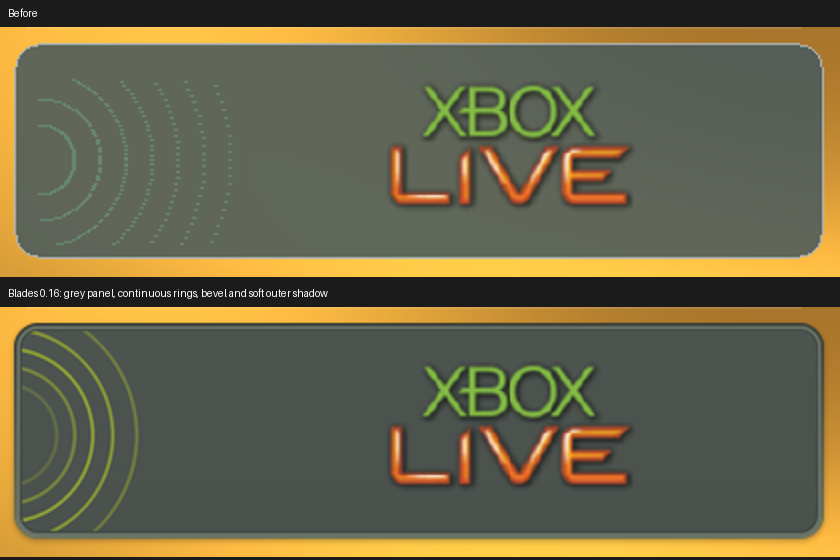

# Blades 0.16 branding and whoosh review

The Xbox Live panel below Chat and IM now has a neutral opaque grey interior,
a recessed bevel, continuous yellow-green rings at the left, and a subtle soft
shadow outside its rounded edge. The Xbox Live logo image itself is unchanged.
The previous translucent fill let the orange swirl tint the panel; its sparse
point-drawn rings also appeared dotted and too widely spaced.

The supplied later-Blades Xbox Live screenshot (`5.jpg`) shows the panel at
approximately x=203, y=405, width=405, height=108. The quiet interior measures
about RGB 76/82/78. Its ring crests near the horizontal centre lie about nine
to twelve pixels apart. The edge has a narrow bevel and soft outer shadow,
rather than a bright single-pixel white outline.

The supplied [DashX360 repository](https://github.com/ZivvoZ/dashx360/tree/7d92705cf2131e6159120cfa5ae10736ddfabf68)
defines this panel in `XboxMetroLauncher/MainWindow.xaml` with a rounded grey
Border and `BladeRingBackground.cs` with yellow-green 181/204/40 rings and
1.8-pixel strokes. There is no separate complete panel-background bitmap in
the inspected tree. This release adapts those design elements to the supplied
reference's dimensions, neutral colour, ring spacing and bevel. It bakes the
background and a fixed ring pose into `branding/live-panel.png` at pack-build
time, with five transparent pixels of padding for the 1.4-pixel soft shadow.
That keeps the background in one GPU texture and avoids CPU ring drawing on
each menu rebuild. It does not add another runtime animation.

The padded texture is 415x118, drawn at x-5, y=400, retaining the original
405x108 panel's position at y=405. Logo size and position are preserved.

## Divider below the top logos

The supplied Xbox Live, Games and Media references show a faint horizontal
groove under the top branding, above the right-hand description. This was
missing. A two-pixel dark groove with a restrained lower highlight now fades
at both ends around y=232. It belongs to the root content, fades with that
content during transitions and is absent from expanded submenus.

## Whoosh progression

Yes: the four supplied boundary cues rise as navigation moves from the left
of the dashboard to the right. The existing mapping already selects these
recordings in the correct order. No pitch shifting or time stretching was
added, and every existing sound payload is byte-identical to v0.15.

| Boundary | Strongest full-clip spectral peak |
| --- | ---: |
| Marketplace ↔ Xbox Live | 446 Hz |
| Xbox Live ↔ Games | 511 Hz |
| Games ↔ Media | 634 Hz |
| Media ↔ System | 766 Hz |

These are peaks in the spectra of noisy sweeps, not musical fundamental
frequencies. The values describe the recordings, rather than prescribing a
runtime pitch multiplier. Moving back selects the same boundary cues in the
reverse order.

The supplied video also contains a rapid increasing-pitch sequence around
28:23–28:25. Downmixed 16 kHz waveform matching found the Live/Games,
Games/Media and Media/System recordings at 1703.4592, 1703.8804 and 1704.3965
seconds, with normalized correlations 0.748, 0.738 and 0.757. Corresponding
video frames show Games, Media and System arriving. The inspected intervals
did not give a confident Marketplace/Live match; that lowest cue retains the
supplied filename mapping. Original sound assets remain pinned to
`0c8adb2cef4ad7dff2bf889351efa1f1c244aef2`.

[Measurements, sample hashes and limitations](data/v0.16-branding-audio-audit.json).

## Delivery and validation

The premade pack has 214 entries: all 213 previous payloads unchanged, plus the
panel texture. Both the matching XEX and artwork ZIP should be replaced.
Source attribution remains included. The new 81-second desktop GPU walkthrough
shows the panel and divider, with full left-to-right and reverse sweeps near
the end so the existing sound progression is easy to hear.

Eleven desktop suites, including all-menu command playback and 113 GPU image
comparisons, passed. Actual-pack stereo mixing was checked sample for sample;
the native XEX passed structural/digest validation. This remains desktop and
build validation; console appearance and performance require a physical 360.

Packaging note: the displayed application/pack version is 0.16.0. The XEX container uses 0.0.16.0 because its minor field is limited to four bits; its 16-bit build field carries release 16. Title ID and import requirements are unchanged.
