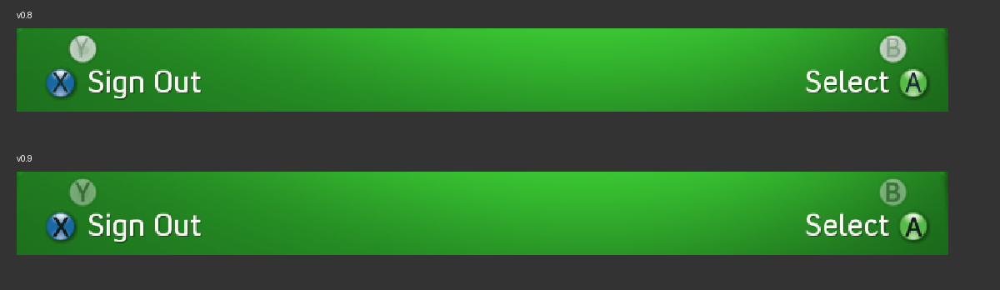

# Blades 0.9 button prompts

The supplied 5766 Games, Live and Console Settings references showed that the
0.8 prompt letters were too tall and thin, and that disabled B/Y prompts were
too bright. Version 0.9 keeps the original 32x32 shared button spheres and
composes dedicated letters from the supplied Convection / Xbox TC font.

The letters have 18-pixel visible height, a mild quarter-pixel outline expansion
and individual alignment using their visible ink bounds. They are rasterised
at four times the target resolution and reduced with Lanczos filtering. Enabled
letters use a dark green-black treatment; disabled sphere/letter composites
use 55% opacity. All eight ABXY enabled/disabled sprites are prepared offline.
These values are visual adjustments against the supplied compressed references,
not recovered retail XUI styling constants or a claim of pixel-exact matching.

The matching pack adds eight sprites to the previous 198 unchanged resources.
The renderer loads these complete sprites first; older packs and missing assets
retain a text/shape fallback. Prompt positions, actions and demo availability
rules are unchanged. This is a visual update.

Validation: all six desktop test suites passed; the matching 206-entry pack
passed resource and renderer checks with AddressSanitizer/UndefinedBehaviorSanitizer.
All 48 menu states were captured for review. The native XEX passed structural
and digest checks. The release video is a fresh desktop capture of the shared
renderer; physical-console appearance still needs user verification.

Artwork credit: zivvoz / DashX360 and Microsoft/respective rights holders.
Font source and notices: [CONVECTION-FONT.md](CONVECTION-FONT.md).
