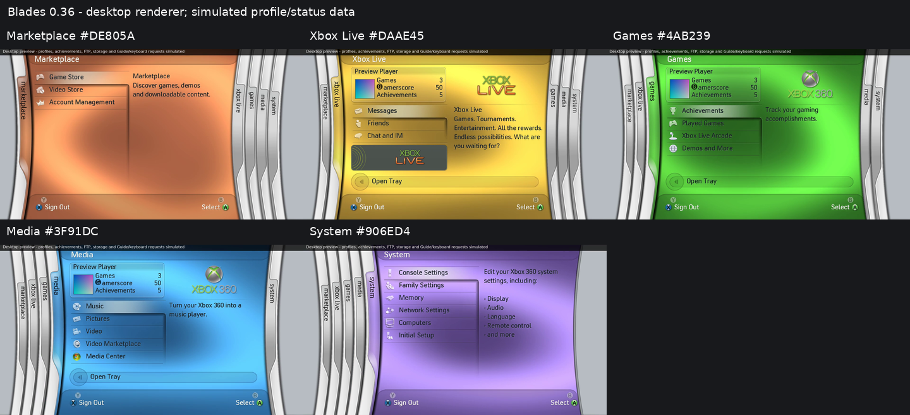
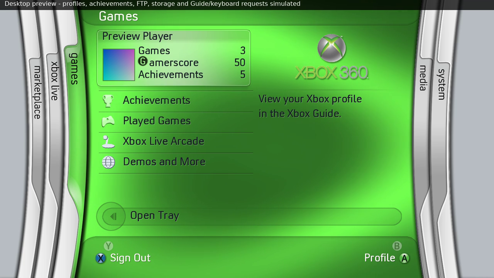
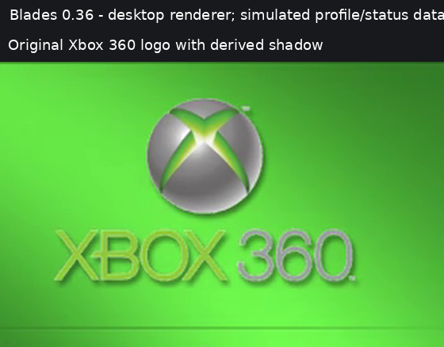

# Reference colours and branding — 0.36

The default-theme blade tints were compared with unobstructed body areas in
the supplied references. Marketplace uses the main 2007 pane in 12.webp; Xbox
Live uses 5.jpg; Games uses video-games.jpg; Media uses the original recording
at 05:09; System uses 7.jpg. Neutral chrome gives a relative channel balance.
The target is reference chroma at the renderer's existing dominant intensity,
so a paused dark swirl or camera exposure does not become a new lighting curve.
The motion,30Hz clock, wave/ribbon geometry and lighting range are retained.
These fitted RGB values are not claimed to be recovered retail XUI constants.

| Blade | Previous tint | Refined tint |
| --- | --- | --- |
| Marketplace | `#DE5B0F` | `#DE805A` |
| Xbox Live | `#DA9739` | `#DAAE45` |
| Games | `#2FB22F` | `#4AB239` |
| Media | `#2596DC` | `#3F91DC` |
| System | `#905BD4` | `#906ED4` |

The sampled body-median channel ratios match the normalized targets within
one 8-bit level after fitting. This is a local colour-fit check, not a claim
of pixel-identical footage: the reference camera and swirl phases differ.
The 25 derived header/footer/tray masks are retinted consistently, preserving
every alpha value, dimension and layout. Original chrome and font data remain.

Gamerscore uses the original GScore PNG and 32px box. Actual 28px Convection
amerscore ink ends at label_y+25; the rendered icon alpha ends at icon_y+29.
Moving its box from148 to142 puts both main-ink bottoms at 171. Its size,
horizontal alignment, word spacing and PNG bytes are unchanged.

The provided repository/local stock resources contain the original Xbox360
logo, but no separate ready-shadowed variant was found. The original
splash_360.png remains byte-identical. A 202x130 transparent shadow mask is
built from that logo's fitted alpha, with 1.5px blur,2px right/3px down offset
and 120/255 opacity. It is rendered immediately behind the original logo on
non-Live roots. The mask is prepared in the artwork pack and cached by the
existing image renderer; no runtime blur or new shader pass is introduced.
Xbox Live's separate logo and promotional tile are retained.

The pack now has 235 entries. Compared with 0.35, only 25 tint masks change and
one derived logo-shadow PNG is added. Every other entry—including the logo,
GScore, font, audio and layout—is byte-identical. Use the matching USB ZIP;
all generation is already done and ownership notices remain included.

Verification includes independent double-precision animation samples generated
with the refined tints, after reproducing the old goldens first. Actual
foreground image/mask pixels verify the GScore/main-text bottom match. A
logo-only test verifies darkening outside the original silhouette without
lightening any pixel. CPU/GPU and sanitizer checks cover the final pack.
