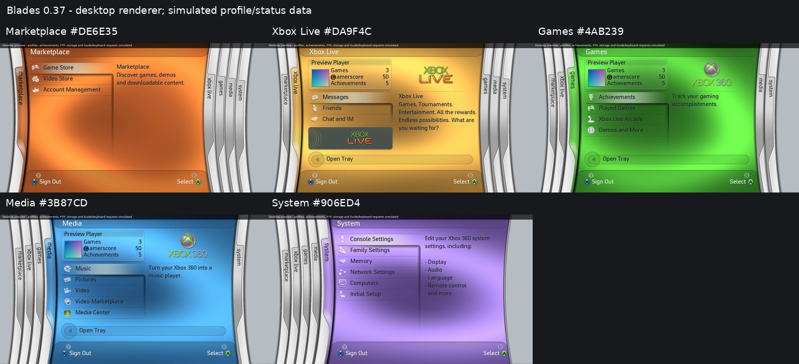
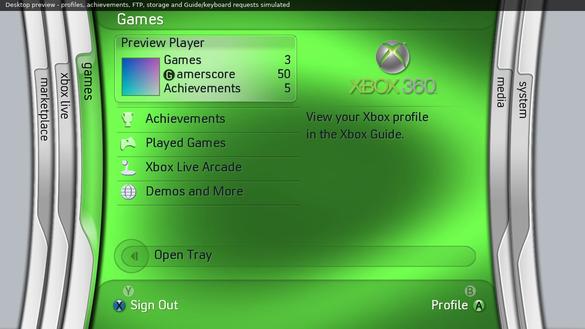

# Console-feedback colours and branding — 0.37

The supplied references and the real/0.35/0.36 comparison were reviewed by the
user. These values apply their feedback, rather than claiming an exact colour
fit to a camera frame. Both the animated field and derived cap/tray masks use
the same palette. Lighting/motion equations and clock are retained.

| Blade | 0.35 | 0.36 | 0.37 | Adjustment |
| --- | --- | --- | --- | --- |
| Marketplace | #DE5B0F | #DE805A | #DE6E35 | Rounded midpoint of 0.35 and 0.36 |
| Xbox Live | #DA9739 | #DAAE45 | #DA9F4C | Keep 0.35 hue/value, soften saturation by about 12% |
| Games | #2FB22F | #4AB239 | #4AB239 | Retain 0.36 |
| Media | #2596DC | #3F91DC | #3B87CD | About 7% darker than 0.36 |
| System | #905BD4 | #906ED4 | #906ED4 | Retain 0.36 |

The Gamerscore G icon returns to its pre-0.36 box y148 (from y142), retaining
x+104,32x32 and the original GScore PNG. Main ink is consequently six pixels
lower than the adjacent word bottom, as it was before the requested rollback.

The stock Xbox360 logo and its cached alpha-derived shadow are unchanged.
The shadow remains a 202x130 PNG with 1.5px blur,2px right/3px down offset and
120/255 opacity, rendered behind the original logo. There is no runtime blur.

The pack still has 235 entries. Compared with 0.36, 15 derived mask PNGs change
(Marketplace, Live and Media slots 7..11). Their dimensions and every alpha byte
are retained. Games/System masks, logos/shadow, fonts, audio, layout and notices
are byte-identical. Use the matching USB ZIP; conversion is already done.

The source references remain the main 2007 Marketplace pane in 12.webp, Live
5.jpg, Games video-games.jpg, Media video at 05:09 and System 7.jpg. Camera
exposure and different swirl phases prevent a literal brightness comparison.
