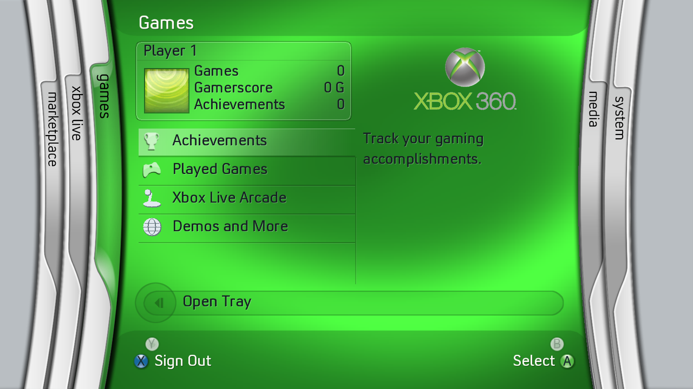

# Convection font support, 0.8.0

Version 0.8.0 renders text using glyphs recovered from the user's
`Convection.Font.for.Xbox.360.JTAG+RGH.zip`. The font is supplied as a local
coverage atlas in the premade artwork pack. Console system fonts are untouched.

## Source and recovery

The main `xenonclatin.xtt` resource identifies its family as **Xbox TC** and
uses 2048 units per em. The archive author describes it as the older Convection
Xbox 360 font. The Japanese/Korean main resource has the same printable-ASCII
advance metrics; the TC resource supplies this release's glyphs.

The XTTF container uses a zlib-compressed table shell and independently
compressed glyph pages. My earlier assessment that it was encrypted was
incorrect. All 271 compressed-page SHA-1 hashes match the original `xchk`
table. The converter reports no clipped glyphs, and all 95 printable ASCII
outline records and original advance/bearing records match the decoded font
exactly.

Input SHA-256:

```
977bbe13d5545d300e57dacf9dff492476452f50880ef3868d3aa308d041187d  xenonclatin.xtt
```

The externally run converter is
[xtt2ttf.py](https://github.com/taglocklar/360dashboards/blob/ad85c697bde95022cf3c9425bb0b51e7c4a9f1e9/tools/xtt2ttf.py),
from the GPL-3.0 `taglocklar/360dashboards` project. It is an offline build aid;
it is not linked into the native application. Its generated standard font
tables permit rasterization of the original glyphs. No decoded TTF or original
XTT container is distributed in the executable or artwork pack.

## Runtime resources

The pack adds three entries to the previous 195 unchanged resources:

- `font/atlas.png`: 1024x384 RGBA coverage, containing 95 cells of 64x64 pixels.
- `font/metrics.bin`: bounded big-endian `BFN1` metadata, 48px em, 16 columns,
  two-pixel left bearing allowance and 1/64-pixel character advances.
- `font/NOTICE.txt`: source/ownership notice.

The loader validates the metadata, image dimensions and advances before using
the face. Text drawing and width measurement use the same fractional advances,
avoiding accumulated per-character truncation. Glyph scale caches invalidate
when the resource pack changes. Missing/corrupt font resources retain the
embedded Apache-licensed Open Sans fallback.



## Validation and scope

Six CTest suites pass. Original synthetic font fixtures check metrics, raster
coverage, scaling, clipping, invalid metadata, cache reload and fallback.
ASan/UBSan passes those paths and all menu/transition rendering with the actual
198-entry pack. All 48 current root/submenu states were captured and reviewed.
The native XEX builds with 17 verified image pages and valid digest/import
chains; mutation tests pass. A fresh 63-second desktop walkthrough is provided.

This recovers the supplied font's glyphs; the application still uses its own
coverage renderer and only its existing printable-ASCII character set. Baked
labels in artwork remain image data. The full layout, rasterization and demo
content are not thereby an identical match to the original dashboard. Physical
console rendering still needs testing.

Font rights remain with Microsoft and the respective rights holders. See
`FONT-NOTICE.txt` in the artwork ZIP and `licenses/CONVECTION-NOTICE.txt` beside
the executable. No flash or system-font replacement is part of installation.
