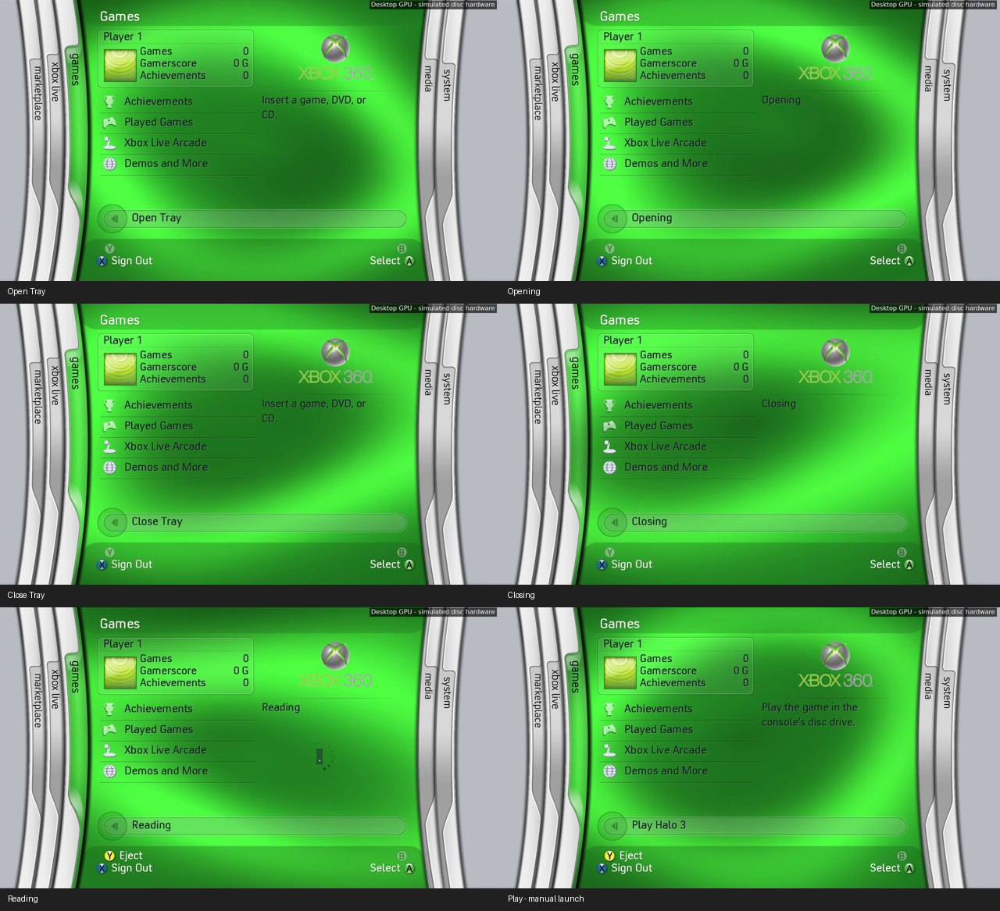
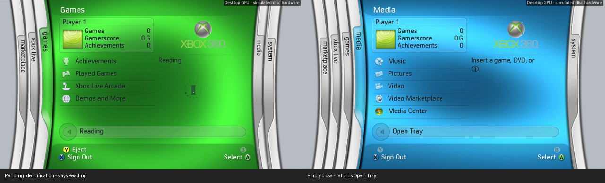

# Blades 0.19 disc drive

Games, Xbox Live and Media now share a working disc row: **Open Tray → Opening
→ Close Tray → Closing → Reading → Play <title>**. A operates the selected row;
Y ejects loaded/reading discs from ordinary menus and submenus. The physical
button updates the same observed state independently of controller input.
Startup checks media for both CLOSED and EMPTY cached tray values, following FreeStyle's initial media-query path. Insertion and starting Blades with a disc present never request launch. A on
Play is required. Busy states ignore A; the row no longer opens a submenu.
Existing modal/startup input guards still apply.

## Hardware and metadata

A monitor polls XAM's cached tray enumeration at 10 Hz and sends requested SMC
tray commands. Media queries and file reads run on a separate worker/core, so
neither decoding nor authentication queries block rendering or tray commands.
The UI copies a small status record. Command feedback is immediate while
awaiting hardware acknowledgement; other changes follow observed states.

Each tray/media cycle has a generation counter. Results finished after eject
are discarded, including replacement by a game with the same title ID. Manual
launch rechecks media, executable, title ID and generation; eject can cancel
that check. The main thread checks the cached tray state again before calling
xsdk_launch. Its preflight failure returns to the running UI; successful
handoff runs cleanup before XAM takes over. Only an accepted Play action can
reach the loader. No console autoplay/configuration setting is modified. The compiled XEX retains system flags 0x21, including NoForcedReboot for tray-eject handling.

Reads use `/Device/CdRom0/default.xex`, independently of drive aliases. The SDK
resolves that device path for XAM. The target is Xbox 360 game DVDs and game/
movie hybrids with a readable default.xex. Original Xbox, CD music and movie
playback are outside this release. Empty, unsupported, unavailable and
unreadable drives have distinct states. A 30-second identification timeout
shows Can't Read Disc; retries and physical tray monitoring continue.

Titles come from bounded UTF-16BE nxeart metadata, or the title-ID XDBF resource
inside default.xex. The reader supports raw, basic data/zero-block and normal
LZX images, including retail AES-CBC using console services. It never loads an
image or calls its entry point for metadata. Tables, strings and allocations
are bounded; only the requested resource is retained instead of allocating the
entire executable. Missing/bad metadata uses Play Xbox 360 Game. Long labels
receive an ellipsis. Game authentication and loading remain with XAM.

## Reference display

The user's second new video, around 05:32–05:42, shows Reading in the tray row
and right-hand panel, with a waisted console inside orbiting dots. Its empty
message is Insert a game, DVD, or CD. The first video also shows detection
around 12:38–12:43, followed by automatic launch on that console. This app keeps
the requested manual launch behavior.

The indicator adapts the console path, 16-dot orbit and 1.7 Hz timing from
[BladesLoadingIndicator.cs in the supplied repository](https://github.com/ZivvoZ/dashx360/blob/0c8adb2cef4ad7dff2bf889351efa1f1c244aef2/XboxMetroLauncher/XboxMetroLauncher.Controls/BladesLoadingIndicator.cs),
using the dark treatment seen in the disc footage. This is adapted vector
artwork, not extracted retail XUI geometry or a claim of pixel-exact timing.
Sixteen transparent 96×96 frames play at 27.2 Hz through the existing GPU
compositor, only while that panel is visible. They are prewarmed before
startup. Other menus retain their cached foreground during disc reads.

The pack has 234 entries; all 218 previous payloads remain byte-identical.
Attribution is included. No reference video or retail dashboard executable is
shipped in the app or artwork pack.

## Validation

The disc suite covers the full cycle, physical-button observations, no autoplay,
explicit launch, Y input edges, stale reads, same-ID replacement, timeouts,
malformed titles, raw/basic/compressed/encrypted decoder plumbing and per-byte
corrupted XEX fixtures. It checks new labels with and without artwork. Circle
primitives now emit identical integer coverage in row spans so fallback buttons
stay within the command budget.

An independent OpenSSL/libmspack desktop codec ran the production parser on
the unmodified supplied retail 5766 dash.xex. It recovered title ID FFFE07D1 and
Xbox 360 Dashboard from the encrypted LZX image. This checked a real resource
layout, including its 0x00010000 XDBF version, rather than only synthetic data.
It does not test native codec calls or demonstrate game launch.

The release's [audit metadata](data/v0.18-disc-audit.json) and
[console instructions](CONSOLE-TEST.txt) distinguish desktop validation from
hardware testing. The fresh walkthrough feeds simulated tray/media observations
into the production state machine. New physical disc control, native metadata
APIs and game launch still need testing on the user's 360.

API facts were cross-checked with XboxUnity/freestyledash revision
df89a42edf055370e3383576c93199a3713c41e9 (DVDMonitor, xboxtools, SMC and XEX
readers), and Xenia's public export/format definitions. No XDK library or
upstream dashboard implementation is linked into this XEX.

## Version 0.19: pending identification and empty close

The user's v0.18 hardware log exposed two incorrect assumptions: media word
FFFFFFFE was masked to 254 and immediately labelled unsupported; a later
return of 5553083B with media word 1 was ignored because the code expected a
zero success return. The return word can carry a title ID. The corrected
classification uses the full documented media word, with invalid/unwritten
values treated as pending rather than an invented unsupported type.

Reading now survives cached CLOSED/EMPTY changes during identification. A
valid game result proceeds to metadata reading even with a nonzero return.
No-media requires two repeated queries after at least three seconds of close
settling, then returns Open Tray. Documented non-game types require three
repeated queries and settling; unknown media gets the existing 30-second
identification window. Polling continues after an unsupported/error result.
Physical opening/closing still invalidates old reads and launch requests.

Regression cases cover the captured pending/title-ID responses, both cached
tray values during an empty close, transient other media, stale results and
recovery. The new 52-second video exercises the shared policy with simulated
hardware, including Reading during pending identification and Open Tray after
an empty close. Native disc operation needs another console test; the v0.18
log's working tray commands and 59.8–60 FPS do not establish v0.19 game launch.

[Version 0.19 audit](data/v0.19-disc-fix-audit.json).
