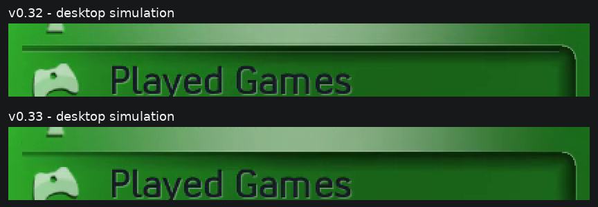
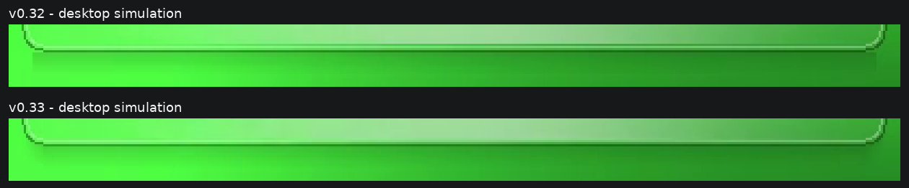

# Highlight/divider join and card shadow — 0.33

The original reference recording was checked at 04:28–04:29 (Achievements),
04:37 (Played Games) and 05:09 (Media/Music), including the selected lower edge
and its join with the right-hand curve. Sign In footage at 04:23 and 22:05 in
the uploaded achievement recording, plus video-games.jpg, was checked for the
card's frame and both lower shadow corners. Camera exposure/compression and
the animated background affect brightness; these are geometric fits rather
than recovered retail XUI constants.

In 0.32 the row sheen stopped at offset 48 and the shadow began at 49, while
the dark divider was at 51–52 and another light line at 53. That placed a line
inside an already-started shadow and made the lower edge appear doubled.
Version 0.33 fills through offset 50 and starts the shadow at the divider
location, offset 51. The shadow covers and effectively replaces the selected
row's divider; that dark/light rule is not painted over the penumbra again.
The selected lip's light bevel is above the contact edge, not a separate bright
rule through the underside. Other rows retain their normal dark/light groove.
During movement, a divider crossed by the shadow's contact band is covered too.
The 53-pixel row pitch, fonts,
icons, sheen tint/width and existing right-side/lower-left shadow taper remain.
Roots, ordinary submenus, library/File Manager and FTP use the same boundary.

The account card had a rectangular shadow strip. It is replaced with a soft
shadow following the rounded frame's lower contour. At either corner the
shadow rises with the curve and fades toward the side, so its tail finishes
sooner there than at the flat centre. It is drawn behind the frame, and both
frame outlines remain above the focus fill. The focus reaches the inner lower
border without painting over it. This applies signed in and signed out.

The 0.32 top/bottom cap shading is retained: header shading is inset and fades
upward from its lower edge; footer shading fades downward from its upper edge.
Its cached original-artwork contours, cap animation and startup opacity are
unchanged. Achievement geometry, FTP status layout, native account/Guide
behavior and the 234-entry artwork payload are unchanged.

The renderer tests compare real pixels with and without focus, checking that
the last fill rows are bright and the selected divider is covered by one
continuous penumbra, without a separate bright stripe through it. They also check both curved card ends
and the clean tail boundaries. Captures use the final renderer and real pack,
with explicit simulated profile/storage/FTP/Guide labels. Physical display
appearance still needs comparison on a 360.
