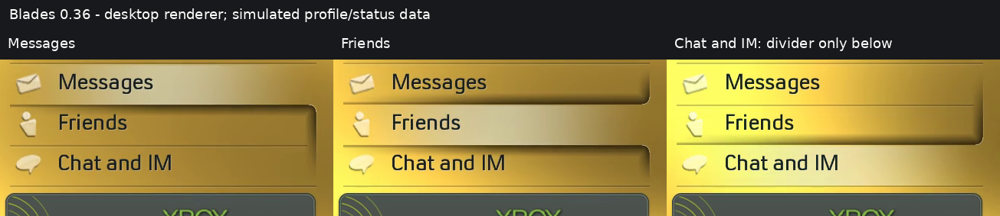

# Xbox Live upper/lower group edges — 0.36

Xbox Live had a root-only flat-shadow override. It generated only a short
horizontal underside, so the vertical right-hand lines were absent even though
other blades used the rounded group geometry. Version 0.36 removes that
exception and uses the existing matching rounded upper/lower shadow routine.

The downward Live group ends at the final button divider: y395 in the current
three-button layout. The endpoint is calculated from the visible list, not the
tray position or promotional tile. The divider remains full-width and visible.
When Chat and IM is selected, its lower shadow starts at that same endpoint,
so there is no downward curve at all—only the divider. Its upper closing group
remains, and the first row still has no upper group.

The raised Xbox Live tile previously covered the continuation of a shadow
painted toward the tray. The group now stops before that tile, avoiding this
occlusion while retaining the tile's original face, bevel and outer shadow.
Menu bounds include the whole button column; no GPU scissor expansion or
painting across the logo is needed. Reference checks include the supplied
Xbox Live still and the original recording around2184–2190 seconds, alongside
the explicit requested bottom-divider behavior.

The 0.35 top alignment, rounded profile-card shadow, fonts, field layout and
cursor motion are retained. This includes FTP's equal86px field pitch and
interpolated selection. The shared shadow profiles are retained. The matching235-entry pack also
refines blade tints and adds a cached shadow for the 360 logo; see
COLOUR-AND-BRANDING.md.

Actual-pack pixel tests cover Messages/Friends downward rails, Friends/Chat
upward rails, the full-width bottom divider and the clear area immediately
beneath it, including the last selection. A logo-face sample must remain
unchanged. The saved0.35 renderer fails the missing-side-edge check. Existing
row/card/mirror/FTP spacing and motion checks remain, with CPU/GPU parity and
sanitizers. Desktop captures do not demonstrate console display appearance.
