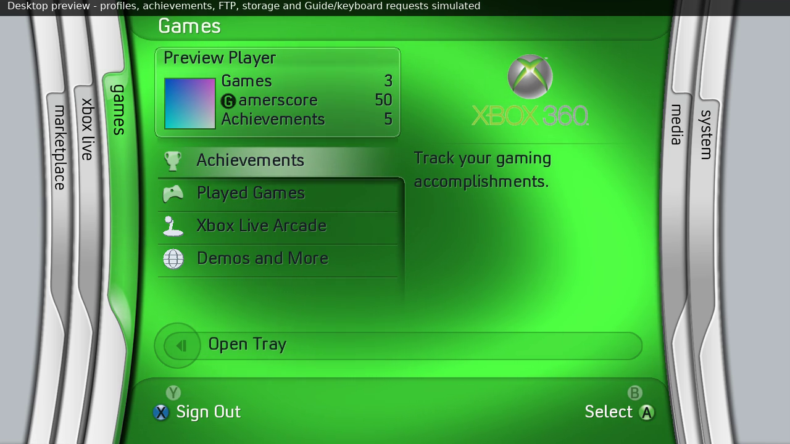
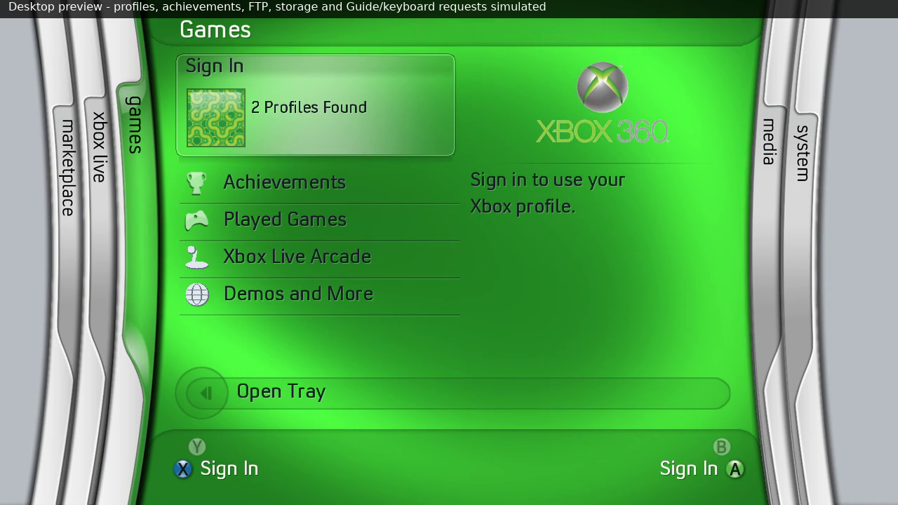
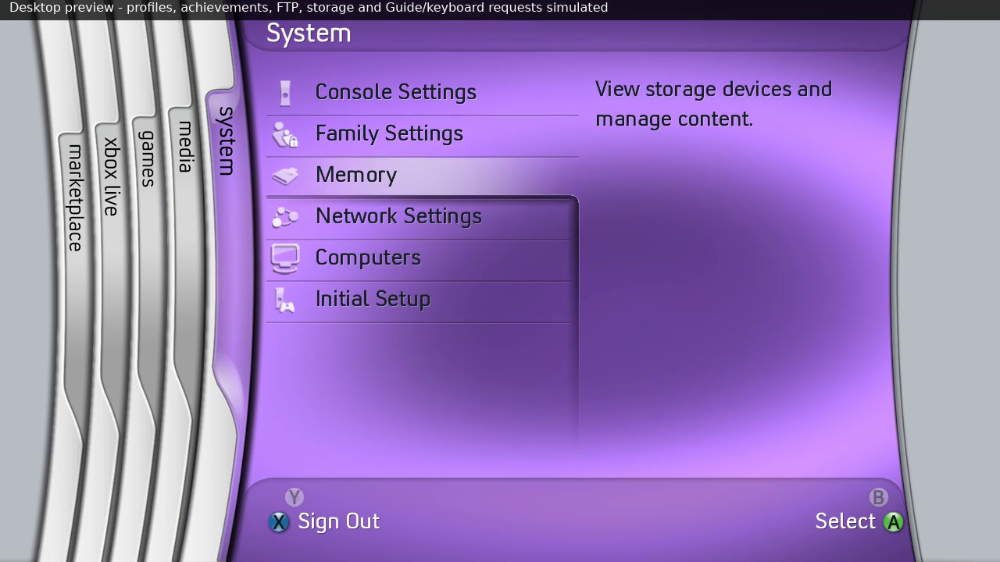

# Focus and bar shading — 0.32

Compared the original dashboard recording at 04:23 (Sign In), 04:28–04:29
(Achievements), 04:37 (Played Games) and 05:09 (Media/Music), together with
the uploaded achievement recording at 22:05 (Sign In) and the System still.
The sheen is fitted from the footage; camera exposure, encoding and the moving
background prevent claiming recovered retail opacity constants.

The 0.31 pure-white sine-squared highlight was too concentrated. The new
slightly warm sheen has broader shoulders and soft top/bottom edges, while
still fading to transparent at either end. Menu rows and the account card use
the same horizontal shape. The card's focus extends to its rounded inner frame,
and its darker name band is composited over the sheen. No hard inner separator
is added. The thin dividing lines between buttons remain visible.

The top bar's shadow sits inside its lower edge and fades upward. The bottom
bar's shadow sits inside its upper edge and fades downward. Their contours
follow the existing artwork's curved edges and animated positions, including
expanded submenus and startup. Small edge arrays are cached on resource load;
PNG decode scratch is freed and idle foreground commands are reused. The
original artwork payload, shader pipeline, audio and achievement spacing are
unchanged.

Final release captures below are desktop simulations using the actual pack.
Physical display contrast/brightness should be compared on a 360.

