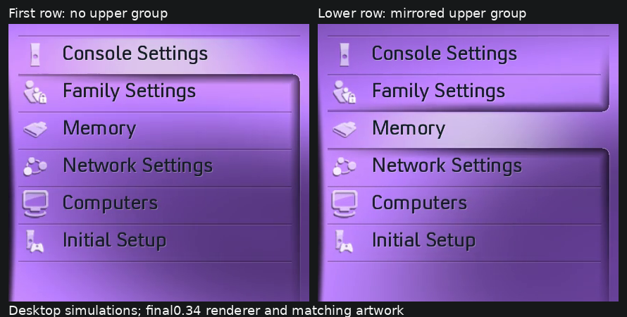
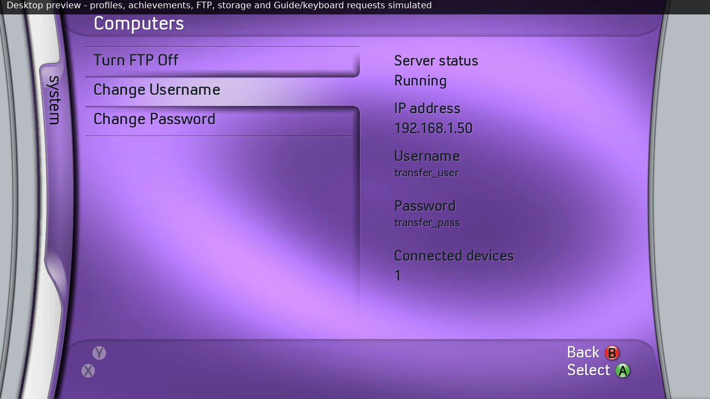

# Upper menu group and top divider — 0.34

The original dashboard reference at 04:37 (Played Games selected) shows two
closing group edges: the area above the selected row curves upward at the
right, while the area below curves downward. At 04:28–04:29 (first-row
Achievements) there is no upper group. These frames, Media at 05:09 and the
supplied System/Xbox Live stills were checked for the first-button divider.
The top divider sits just above the first row; it was missing in 0.33.

Version 0.34 reflects the existing downward shadow routine vertically to
render the upper one. The two share the same opacity, penumbra, contact fade,
right-hand contour and bevel. The existing flat Xbox Live root style is
reflected as flat too; rounded menu styles retain matching rounded corners.
The upper group is clipped between the first visible row and the top of the
selection. It is absent on the first row, including a scrolled library whose
selected row is the first visible entry. During movement its height follows
the actual animated highlight position.

A two-pixel dark/one-pixel light divider is restored four pixels above the
first button. Roots, ordinary submenus, FTP controls and nonempty library/File
Manager lists use the same placement. Grooves inside the upper/lower groups
stop before their right-hand side shadows; the contacts replace the grooves
immediately beside the selected row, avoiding hard lines through the shadows.

The 0.33 selected fill/lower-shadow join, curved profile-card shadow, other
menu spacing, fonts/tint and original artwork payload are retained. Header/
footer cap shading is unchanged. The upper implementation reflects solid spans
synchronously into the existing foreground command cache, without new image
allocations or changes to the GPU shaders.

Tests compare every upper-shadow pixel with the reflected lower output for
both existing styles, check first-row absence and upper-group clipping, and
verify the top divider on all five roots and FTP. Existing row/card checks
remain. CPU/GPU comparisons add six animated highlight positions. Reference
camera exposure and console display appearance are separate from pixel parity;
the desktop simulation is not a console capture.
