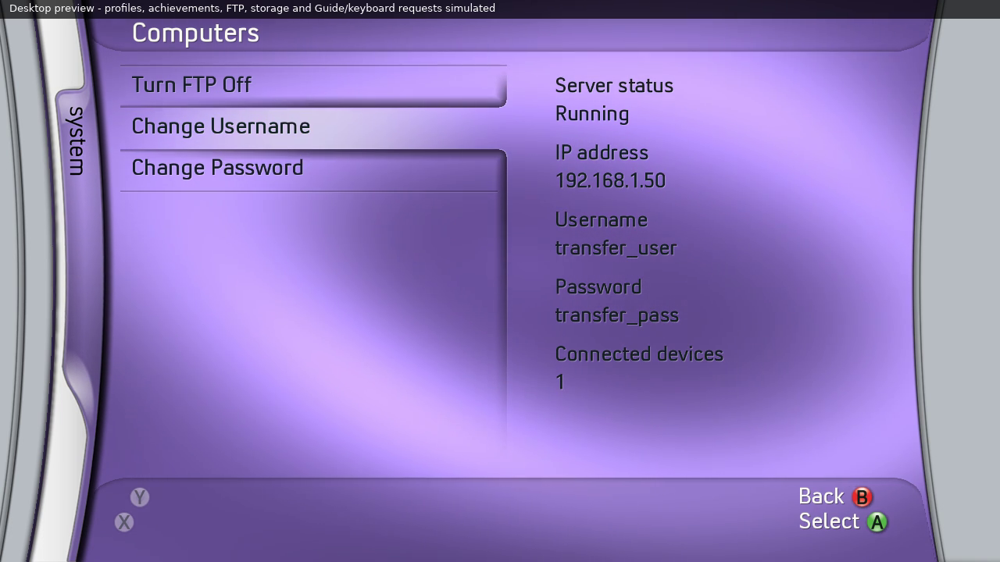

# FTP server — Blades 0.36

FTP starts when the startup animation finishes and Blades reaches the main
menu. It runs across every blade and submenu, including while the Xbox Guide
is open. Opening Computers is not required for a computer to connect.
The default is on. System → Computers has Turn FTP Off / Turn FTP On,
Change Username and Change Password buttons. It displays the current username
and password in the right-hand column, between IP address and Connected
devices. The left column contains the three controls. Long saved values wrap
inside the status column and push the following field down, above the footer.
FTP is no longer under Media Center; it continues running across all blades.

Connect from a computer on the console's network:

| FTP client field | Value |
| --- | --- |
| Protocol | FTP, plain/unencrypted; passive mode; IPv4 |
| Host | The console IP shown in Computers |
| Port | 21 |
| Username | Current value in Computers (initially blades) |
| Password | Current value in Computers (initially blades) |

In FileZilla's Site Manager select FTP and “Only use plain FTP”. These are
Blades' initial FTP credentials, separate from Xbox profile credentials. There is
no SSH, SFTP, TLS or encryption/decryption worker.

The initial `/` directory lists available storage drives: HDD, USB0, USB1,
USB2, MU0, MU1 and InternalMemory as applicable. Absent drives are omitted.
Enter a drive folder to browse its files, upload/download, create folders,
rename or remove ordinary entries. The virtual root and drive roots cannot be
removed/renamed. Xbox Flash/NAND/device namespaces are not exported. Directories
and files are resolved underneath the selected exported storage drive.

The device count uses unique IP addresses among authenticated connections.
For example, a computer opening browsing and transfer sessions counts once.
Up to four control sessions are supported. Passive data ports are allocated
as needed and only accept the same peer IP as their control connection.

Press X in File Manager to refresh its current folder after an upload or
removal. This preserves the current folder and updates the listing.

Turning FTP off closes the listener and disconnects current sessions, including
pending data connections/transfers. An interrupted upload can leave a partial
file; the server does not report it as a completed transfer. The console IP
continues to be displayed when FTP is off. With no address yet, the enabled
server shows Waiting for network and retries. Bind/listen failures show
Unavailable and are retried; default.log records the error number, never login text.

The toggle and current login details are written on a worker to `Blades/Config/ftp-settings.txt`, using a
flushed temporary file and rename. On the next launch they are read before opening
the listening socket. A missing file defaults to on with username/password blades. Existing v0.30
boolean-only files retain their on/off choice and use the initial login. An unreadable/invalid
setting or failed save is reported in the status. An off setting remains off
until the user enables it. Final pending changes are saved during normal exit.
Release ZIPs exclude this file and its temporary file, preserving local choices
when extracting an update over the existing installation.

Networking, directory enumeration, file transfers and settings I/O run on
workers. Xbox workers use a lower scheduling priority on hardware thread 5;
rendering exchanges only a small locked snapshot. Each connection uses a
64 KiB streaming transfer buffer. There are no whole-file reads into RAM.
The foreground draw cache only responds to FTP changes on the Computers
page. FTP stops and joins its workers when Blades exits or successfully hands
off to another title; failed launch preflight leaves Blades and FTP running.

Supported commands include USER/PASS, PWD/CWD/CDUP, LIST/NLST/MLSD/MLST,
PASV/EPSV, binary RETR/STOR/APPE, REST, SIZE/MDTM, MKD/RMD/DELE, RNFR/RNTO,
TYPE, UTF8 options, FEAT/SYST/NOOP and QUIT. Active PORT/EPRT is unsupported.
The native SDK uses signed 32-bit seek offsets, so resume is limited to
2 GiB − 1. Large-file sequential transfer and native storage throughput still
need a physical-console check; loopback tests use smaller files.

The v0.31 behavior was validated by 21 host suites, 290 CPU/desktop GPU comparisons and an actual
loopback FTP integration fixture. The fixture uses Python's ftplib against the
production C server and actual temporary storage, covering authentication,
root drives, passive listings, binary transfers/resume/append, metadata,
Unicode names, filesystem operations, virtual path boundaries, unique-device
counting, cancellation, both saved-state directions and save-error reporting.
The same integration fixture passes ASan/UBSan/LSan. Tests do not emulate XAM's
network stack. Check HDD/USB uploads/downloads, real IP/device counts, off/on
across restart, reconnect after unplugging Ethernet and dashboard smoothness
on a physical Xbox 360; send default.log if any part fails.

The fresh walkthrough is desktop GPU playback with explicitly simulated FTP
status, devices and storage. It demonstrates the screen/toggle/navigation,
not an actual console FTP transfer.

Credential editing uses the native Xbox keyboard. Confirm 1–63 printable ASCII
characters to apply a field; cancellation leaves it unchanged. Login changes
disconnect existing sessions so new connections must authenticate with the
updated details. Both fields are saved together with enabled state. The file
contains plain text fields `enabled`, `username`, `password`; its contents and
temporary file are excluded from every release ZIP. The UI displays the full
current values, wrapping long values as needed. The protocol integration test
changes credentials, verifies new logins after a server restart and checks the
v0.30 setting upgrade. Native keyboard cancellation/input requires a console check.

Version 0.32 changes presentation only. The five relevant renderer/resource/skin/
startup suites pass, including 292 CPU/desktop GPU comparisons and long login
values with both edit controls selected. The server and settings format are unchanged.

Version 0.33 aligns the selected control fill, divider and underside: fill
through row offset 50; shadow from 51 covers/replaces the selected divider.
Other controls retain their grooves. The selected bevel is above the lip.
The shadow adds no independent horizontal glint. The status layout, credentials,
network behavior and persistent settings remain unchanged.

Version 0.34 adds the top divider above Turn FTP On/Off. Change Username and
Change Password selections gain an upper shadow matching the lower shadow;
the first control has no upper group. Status/login fields and server behavior
are unchanged.

Version 0.35 uses the same cursor interpolation as ordinary submenus for all
three controls and their shadows. Selection actions still target the chosen
button immediately; cursor motion does not delay an edit or toggle request.

Single-line status groups now have identical 86px pitch: label positions 94,
180,266,352,438 and value positions 130,216,302,388,474. Every label/value pair
has a 36px gap and each value/next-label pair a 50px gap, matching the original
Server status/IP pair. Values share27px type for ordinary text. If login text
needs wrapping, all values share20px type; each extra26px line moves following
fields down while retaining the same 50px gap after the last value line. The
maximum supported login strings remain inside the status column and footer.

Version 0.36 retains the 0.35 field spacing and cursor-animation fixes.
