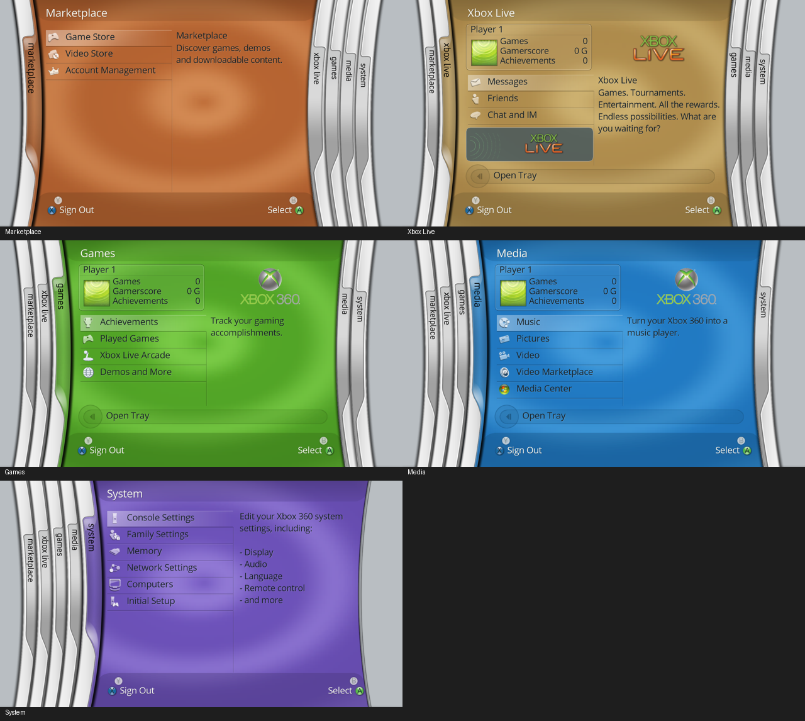
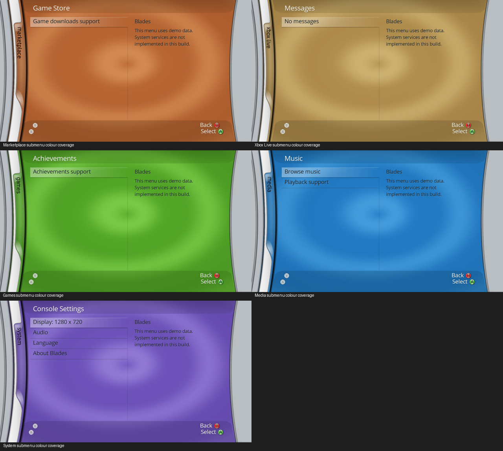

# Menu alignment and transparency, 0.6.0

This pass reviews all five blades, every root selection and each of the
current demo submenus. The preview uses the same renderer and artwork pack
as the native executable. The supplied 5766 recording is the main placement
reference; the supplied still images supplement it.

| Menu | Reference reviewed | Corrections |
| --- | --- | --- |
| Marketplace | Partial Marketplace view in `12.webp`; shared 5766 frame controls | Translucent header/footer, dark selected lettering, row/separator alignment and aligned prompts. A full standalone storefront reference is still unavailable; its demo content is not a verified storefront match. |
| Xbox Live | `5.jpg` | Content starts at x=202; gamer card starts at y=76 with a translucent border and light name strip; menu at y=238; promo panel, description wrapping and tray repositioned. |
| Games | `video-games.jpg`, recording around 04:29 | Card/menu spacing, square gamer picture, right-aligned statistics, 190x118 logo, subtle selection sheen and tray at (262,536). Joystick/globe fallback glyphs replace the mismatched console/disc symbols. |
| Media | Recording at 05:09, `3.jpg` for shared structure | Same card/menu anchors as Games with the Media x offset, undistorted icons and logo, tray at (306,536), and matching music description wrapping. |
| System | `4.jpg` six-row layout and `7.jpg` icon proportions | Narrow console glyph, wide memory/network glyphs, shared icon centers, dark selected text, description column and translucent highlight/separators. The seven-row camera-connected variant in `7.jpg` differs from the current six-row menu. |
| Submenus | `version-screen.jpg`, recording Console Settings/Pictures and navigation samples | Content starts at x=154, rows at y=87, list width 495 and description at x=685. Removed generic root-style icons from these text lists. Back/Select use right-aligned text; disabled X has no Sign Out label. |

## Submenu colour coverage

Additional checks use `8.jpg` (Storage Devices), `9.jpg` (Gamer Picture),
`6.jpg` (My Games), the supplied Console Settings frame and recording samples
of Achievements, Demos and More, Pictures, Arcade and setup screens. Their
coloured surface continues beneath the active tab, the curved side folds,
and the full header/footer. The game-library reference is a later full-screen
layout; it is not used to impose blade positions on the expanded 5766 shell.

The old inner-content clip left the active tab grey and cut the expanded
surface off at straight vertical edges. `BSK2` now includes separate per-row
root and expanded surface boundaries traced from the actual alpha silhouettes.
The expanded active rail moves to x=24, and the right runner anchors at x=1165;
the colour continues beneath their curved transparent regions. Header/footer
masks stretch to the expanded shell before the outer silhouette is clipped.
The interpolation uses the same easing as the blade movement, keeping the
coverage attached to the chrome during submenu open/close.

The 720p shared profile-card anchor moves from y=83 to 76; the first profile
menu row moves from y=246 to 238. The header is 68px high and the footer starts
at y=610. The Games tray bar moves from (218,526) to (262,536), with its circle,
arrow and text sharing the same anchor. Button text uses measured widths so
it remains aligned with its button across blade and submenu layouts.

The cropped settings glyphs were previously forced into a 34x34 square. The
converter now retains each source icon's 64x64 design canvas and transparent
padding. Runtime menu icons fit within a 40x40 box while preserving aspect
ratio; this also protects non-square fallback resources. The gamer tile is
80x80, rather than 84x78. Frame, card and highlight layers blend over the
background instead of replacing it with opaque gradients.

## Verification

- Four CTest suites pass, including a regression check that a 2:1 image remains
  2:1 inside a square icon box, with clipping and reload checks. Synthetic
  expanded-shell tests preserve colour in the tab and outer curved areas on
  all five blades, at the top, middle and bottom and during expansion; exterior
  pixels remain grey. Invalid expanded bounds are rejected, and legacy `BSK1`
  packs remain supported.
- All 24 root selections and 24 corresponding submenus were captured and
  inspected with the actual 195-entry artwork pack. The root menu images and
  reference comparison are retained under `build/alignment-v0.6` locally.
- AddressSanitizer/UndefinedBehaviorSanitizer passes for resources, malformed
  skins, and all menu/transition rendering with the actual pack.
- The native PowerPC XEX builds; all 18 image pages and header/image/import
  digest chains validate. XEX corruption/truncation tests pass.

The menu font is still Open Sans, profile data and service menus remain demo
content, and the background is procedural. The photographs and recording
have lighting/compression differences; this pass does not establish an
identical pixel match. The 0.6.0 changes still need physical-console testing.

Art credit: original project by zivvoz / DashX360, inspired by Microsoft's
Xbox 360 Dashboard interfaces. Asset ownership remains with the respective
rights holders. See [DASHX360-ASSETS.md](DASHX360-ASSETS.md) for pinned sources.
