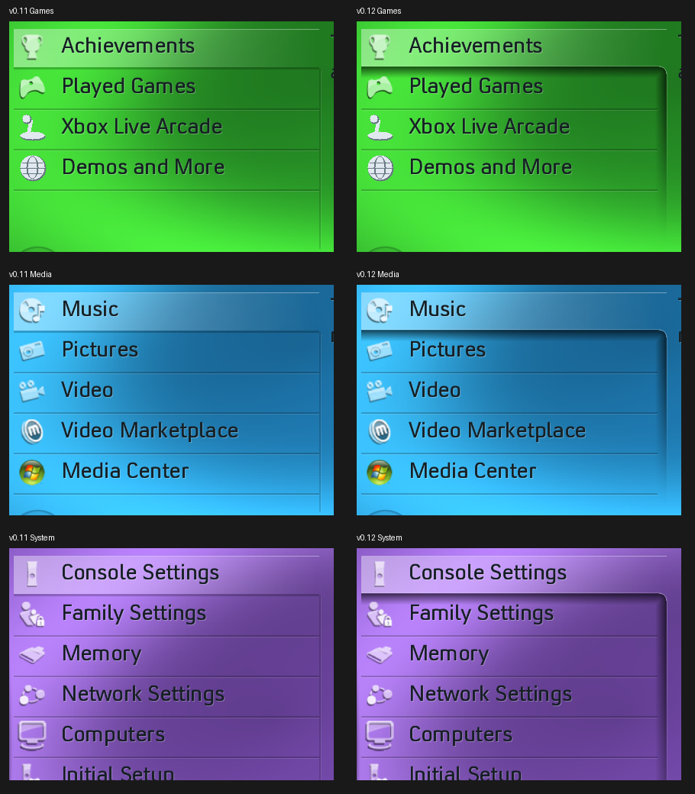

# Blades 0.12 selected-menu shadow

The original Games, Media and System references show a broad shadow immediately
beneath the selected row, curving into the right edge of the lower menu and
fading toward its bottom. Version 0.11 supplied a one-pixel lower rule and a
hard two-pixel vertical line, leaving this depth effect mostly absent.

Version 0.12 replaces those rules with a sampled soft penumbra extending about
15 pixels, a roughly 10-pixel rounded join and a right-edge shadow that fades
with the remaining menu height. A thin outer highlight supplies the bevel.
The shadow moves with the interpolated selection position. Selected text keeps
its existing dark treatment; the change concerns the raised row/menu surface.
Row dividers below the selection stop short of the shadow instead of cutting
through it. Divider overlap follows the animated highlight, keeping the soft
edge intact while navigating between rows. Xbox Live's root list uses the flatter, horizontally fading
underside visible in its reference, without the strong curved right shadow.

References checked: supplied Games still, Media recording around 05:09,
System still, Console Settings still and Xbox Live still. The idle Games and
Media underside profiles fall from roughly 60% darkening to the background
over about 12–15 pixels; their right edge also softens and fades downward.
The recordings show narrower shadows in some navigation frames. That varying
spread has not been reconstructed; this change targets the idle treatment.
The profile and radius are visual fits, not recovered retail XUI constants.
No matching standalone selection-shadow texture was found in the supplied
shared archive or the inspected DashX360 artwork.

All 48 root/submenu snapshots were captured with the actual pack, with first,
middle and last menu rows reviewed. Existing desktop checks and the actual-pack
renderer bounds checks passed, along with AddressSanitizer/UndefinedBehaviorSanitizer.
The native XEX passed structural/digest validation. A fresh 63-second desktop
walkthrough uses the new renderer and matching artwork/sound pack.
Physical-console shadow appearance and rendering cost remain unmeasured.

The 213-entry pack payload is unchanged; this is a renderer update. The shadow
uses bounded drawing and no per-frame allocation. Existing artwork/font/audio
attribution remains in the premade ZIP and runtime notices.
