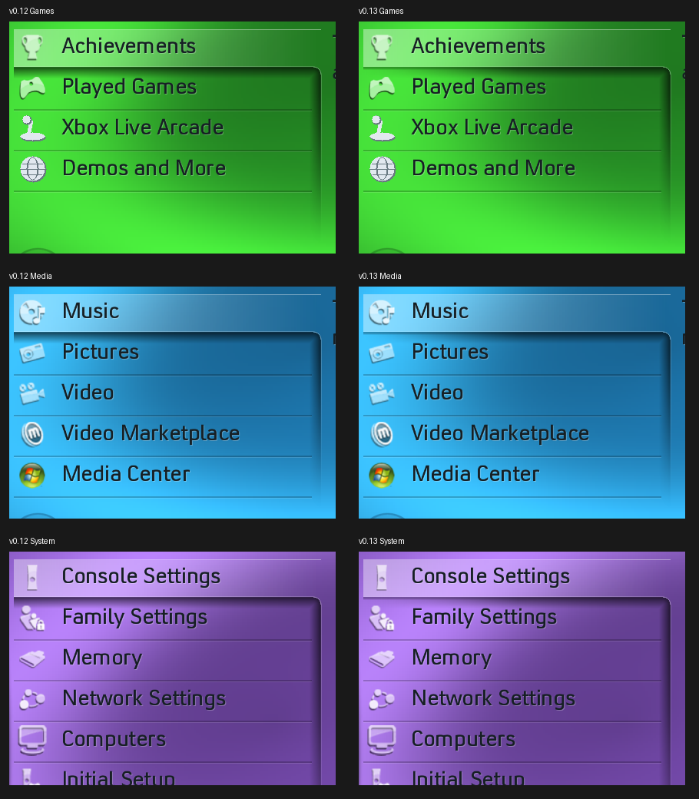

# Blades 0.13 selected-menu shadow

The reference Games and Media undersides soften toward the selected row's
lower-left corner. Version 0.12 supplied the same full penumbra across most
of the underside, making that end look too dark and abrupt. Version 0.13 adds
the missing horizontal fade: a thin contact edge remains at the left, while
the broad shadow develops gradually toward the middle and right. The bevel
follows that taper. The rounded right corner and downward fading edge remain.

## Reference check

The supplied Games still, Media recording around 05:09, System still, Console
Settings still and Xbox Live still were checked across the shadow's width.
In the Media example, local green-channel contrast estimates rise from roughly
30% darkening at the left edge to roughly 60% near the middle. The soft tail
under the left edge disappears much sooner than at the right. These estimates
use nearby unshadowed row samples and are affected by the moving background,
photography and compression; they are not recovered XUI opacity constants.

The renderer now blends a narrow contact profile into the existing 15-pixel
soft profile over approximately half the row width. This removes the broad
dark tail at the lower-left while retaining a readable edge. Xbox Live keeps
its flatter shadow, with the same left taper and a softer falloff past its
centre. Its previous fade ran in the opposite direction.

Version 0.12 introduced the rounded join and softer right edge, replacing
0.11's hard rules. Row-divider clipping still follows the animated highlight,
so the penumbra stays intact while moving between rows. The recording shows
additional shadow-spread variation near navigation which remains approximate.
No matching standalone selection-shadow texture was found in the inspected
shared archive or DashX360 artwork; these profiles are fitted from the images.

## Verification and packaging

All 48 root/submenu snapshots were captured with the actual pack. The existing
eight desktop suites and actual-pack renderer bounds checks passed, together
with AddressSanitizer/UndefinedBehaviorSanitizer. The native XEX passed
structural/digest validation and verifier mutation checks. A fresh 63-second
720p desktop walkthrough uses the new renderer and matching stereo audio/pack.
Physical-console shadow appearance and rendering cost remain unmeasured.

The 213-entry resource payload is unchanged. This is a renderer correction;
equal-alpha drawing spans are batched and no per-frame allocation is added.
Existing artwork/font/audio attribution remains in the ZIP and runtime notices.
