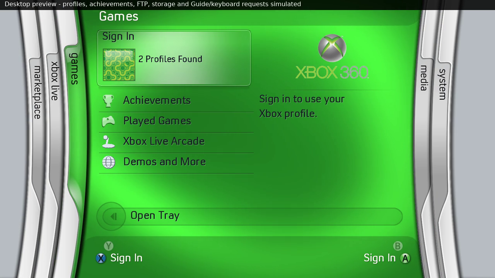
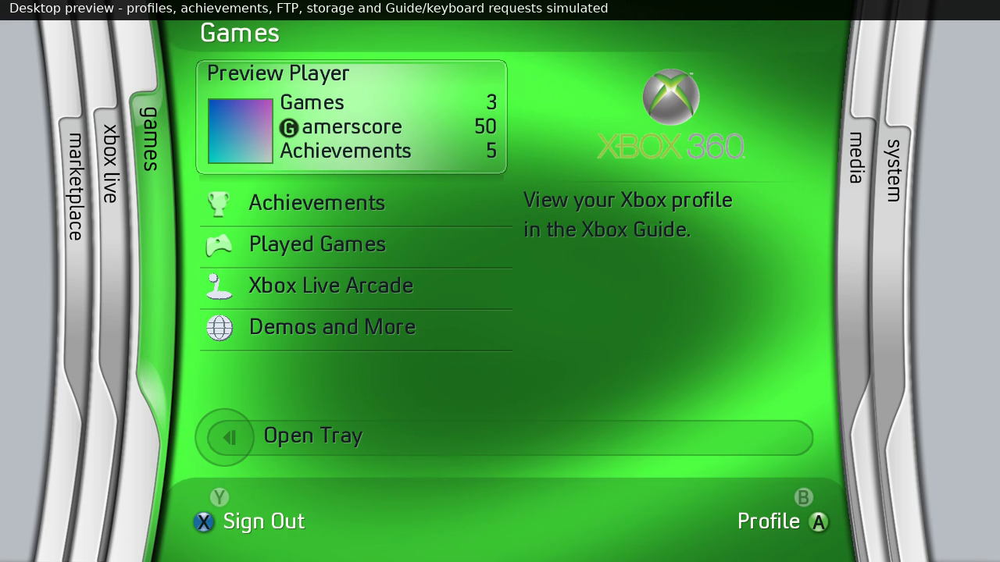

# Profile integration — 0.31

The account card is selectable on Xbox Live, Games and Media whether signed
in or signed out. Up from the first menu item selects it; Down returns to the
menu. A opens native Guide sign-in when signed out, or the current user's
native Guide profile/gamer-card view when signed in. Focus remains on the card
when sign-in completes, and its display cache follows identity/data changes.
At a blade root, X requests the Guide sign-out interface when signed in.
The previous custom sign-out confirmation has been removed. Blades does not
perform a direct background sign-out; the user completes/cancels it in the Guide.

The main thread calls XamShowSigninUI(1,0), XamShowSigninUIp(user,1,4) for the
sign-out-enabled picker, and XamShowGamerCardUI(user). Dynamic ordinals are 702
and 708 for the latter two calls. Targeted actions validate the captured user
slot and XUID immediately before opening; an existing system UI blocks another
request. Rendering continues while Guide input is active, then input is rearmed
on close and profile metadata refreshed. The original retail 5766 dashboard's
calls confirm the user-index arguments for ordinals 702 and 708. The sign-out
flag is XSSUI_FLAGS_ALLOW_SIGNOUT (4). Native appearance/actions still require
physical-console verification; desktop previews show labeled request notices.

Signed-out profile count now checks the standard public package locations on
available HDD, USB and memory devices:
`Content/<profile ID>/FFFE07D1/00010000/<profile ID>`.
Only the STFS magic and public content-type header are read. Account records,
passwords, keys, PINs and GPD payloads are not decoded. Profile IDs are deduplicated
across devices; common content/non-profile files are excluded. An unreadable or
unavailable result remains unknown rather than becoming an invented zero.
The earlier generic current-title content query could report zero for profiles
belonging to the system dashboard. Counting runs on the profile worker and
refreshes while signed out and after Guide activity.

Signed-in cards read the active user's gamertag and real local games, gamerscore
and achievement totals through XAM. Unknown fields show --. Gamer pictures first
request the current user's local gamer tile (type 4), then normal gamer tile
(type 2), independently of the profile's picture-key string. Keyed type 9 is a
last fallback when a valid key exists. ARGB pixels are converted to RGBA for
the renderer. Transient picture failures preserve the last valid picture for
the same identity; changing identity clears it. Missing pictures use the
neutral default tile, not a canned picture presented as the user's choice.

The card name band and lower shadow now fade without a hard inner separator.
Thin row dividers remain visible, including below selected rows.
The selection sheen peaks at the centre and fades toward both sides, sharing
the menu-row highlight shape. Reference: uploaded achievement video near 22:00
(1320 seconds), a clear Sign In / 10 Profiles Found frame. Its row-100 RGB
samples go from (87,160,77) at x110 to (182,204,178) near x210, then
(86,171,67) at x305. The supplied video-games.jpg remains the signed-in card and
Gamerscore G alignment reference. The original GScore PNG and centring are
unchanged. Xbox Live information now has a 28-pixel gutter past the button
column and word-wraps inside its own panel.

The profile worker revalidates identity after reading metadata/pictures.
Snapshots and cached images stay in RAM and are not packaged in releases.
Actual-adapter host fixtures verify current-user tile/stat arguments, picture
retention, Guide targets/flags and stale/busy guards. A real-directory fixture
checks package counting, cross-device duplicates and invalid/common exclusions.
The walkthrough's accounts/pictures/counts are explicit simulations; check
actual Guide actions, profile pictures/counts and account changes on a 360.

