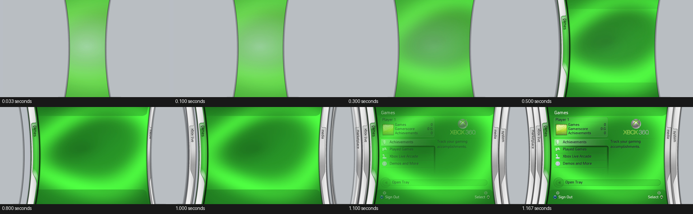

# Blades 0.17 startup animation

Launch now plays the short dashboard opening: curved silver shutters move
apart, the green surface and cap shading emerge, the blade stack settles,
and the menu content fades in last. It finishes on the existing **Games main
dashboard**, with the first item selected and normal navigation available.
It does not enter the reference recording's first-run language/setup screen.

This is live rendering through the existing GPU compositor. No Xbox 360
console boot video, sphere animation or prerecorded dashboard footage is
embedded or played by the application.

## Reference and assets

The supplied recording shows the dashboard opening at approximately
8.07–9.23 seconds, after the unrelated console boot footage. The inspection
used its original 30000/1001-fps frames, resized to the 1280x720 design grid.
Centre-row shutter positions were measured from image gradients on rows
358–362. The resulting opening keys retain the narrow initial reveal and
rapid outward movement. Late blade-stack staging adapts the supplied
DashX360 timeline to the normal five-blade Games shell; the recording's
onboarding shell has a different final layout.

The two moving PNGs are the actual supplied assets:

- `Assets/Blades/Startup/anim-left-runner.png`
- `Assets/Blades/Startup/anim-right-runner.png`

Source: [zivvoz / DashX360, pinned revision](https://github.com/ZivvoZ/dashx360/tree/0c8adb2cef4ad7dff2bf889351efa1f1c244aef2).
The importer resizes them to the design grid, crops transparent bounds and
stores their placements. Curves and shading remain intact. The early green
reveal is the repository's radial XAML brush, baked once into a small texture.
Side-leaf offsets use its `BladesArtworkHost` startup staging, scaled to 720p.

The 218-entry pack retains all 214 previous payloads byte for byte and adds
`startup/left.png`, `startup/right.png`, `startup/layout.bin` and
`startup/reveal.png`. Existing fonts, icons, panel shadow and sound recordings
are unchanged. Attribution remains included.

## Timing, audio and input

The opening lasts approximately 1.17 seconds. Content arrives during the last
six frames. Startup uses elapsed wall time rather than a frame count and
ignores non-finite/negative deltas. Its final pose matches the existing main
root exactly, so completion does not switch to a different screen model.

The reference audio matches the supplied `dash_2ndLevelClose.wav`, already
stored as `audio/menu-close.wav`. A 16 kHz mono waveform search found an
alignment at 9.3407 seconds with normalized correlation 0.722. The startup
sound event plays that complete stereo recording once at the late content
reveal, at 1.0 second; the recording's capture A/V delay is not deliberately
reproduced. This is a reference-guided cue, not a recovered original XUI timer.
No pitch shifting, trimming or synthesized replacement whoosh is applied.

Navigation is suppressed during the short opening. The input layer requires
held buttons to be released before navigation afterwards, preventing a held
A button from immediately entering a submenu. The Guide remains handled by
the existing platform path. Ordinary menu sounds/transitions are unchanged.

## Performance and diagnostics

Before starting its animation clock, the Xbox backend decodes/uploads the
normal root and launch artwork and reserves the fade render target. It keeps
those textures resident throughout the opening. Each frame uses the existing
textured-quad path, with GPU alpha blending and the same 30 Hz swirl. The
startup clock stops after completion; it does not keep rebuilding an idle UI.

Expected log sequence includes startup artwork prewarming, blade opening,
`startup: complete; main Games menu ready`, and both GPU pixel checks. The
swirl-source check still runs on the first frame. The final-background check
waits until the startup shutters have cleared, so it checks an unobstructed
main-menu pixel rather than a silver panel.

The user's v0.16 hardware log established 59.9–60 FPS idle, no idle missed
frames, and 55.5–59.9 FPS during navigation. The new startup path still needs
physical-console validation; the accompanying 81-second video is fresh
desktop GPU playback with the matching 218-entry pack.

## Checks

Twelve desktop suites passed. Startup checks cover its one-shot sound,
wall-clock completion, input suppression, Games-root landing, measured edge
positions, invalid deltas, 36 guarded render/command frames, and exact settled
pose equality with the normal root. Desktop GPU comparisons cover those 36
frames plus the previous 113 menu/background/transition cases. ASan/UBSan
checks and native XEX structural/digest validation also passed.

[Measurements and validation metadata](data/v0.17-startup-audit.json).

Replace both `default.xex` and the matching artwork pack. Check the opening's
smoothness, the complete whoosh, normal main-menu landing, Guide open/close,
and navigation after releasing any buttons held during launch.
