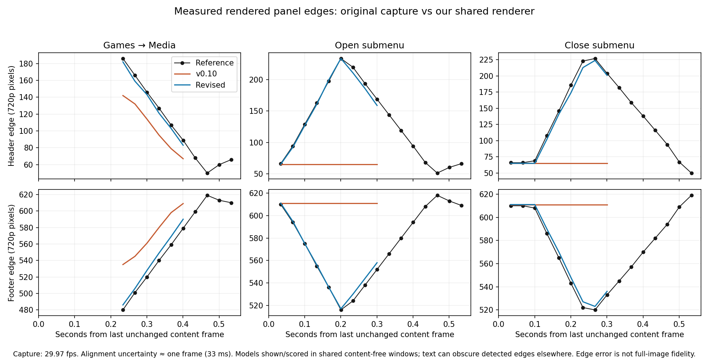

# Blades 0.11: measured transition comparison

The supplied original-dashboard video was compared frame by frame with the
0.10 shared renderer, then again with the revised 0.11 renderer. Submenu
transitions were substantially too short, their header/footer never folded,
and geometry was eased twice. Blade switches had a reasonably similar total
duration but an incorrectly shallow incoming panel and a curved rather than
near-linear wipe trajectory.

## Reference coverage and method

The original capture is 1920x1080 at 30000/1001 fps. Frames were extracted at
their native presentation timestamps and scaled to the renderer's 1280x720
canvas. The shared renderer was sampled at that same rate. Sequences were
aligned to the last unchanged content frame, not to an inferred button press.
The onset uncertainty is about one captured frame, 33.37 ms. We did not use
whole-image difference as a fidelity score: backgrounds, text, scene content
and artwork geometry differ.

| Original-video sequence | Last unchanged frame/time | Compared behaviour |
| --- | --- | --- |
| Games → Media | 9195 / 05:06.8065 | Wipe and incoming caps/content |
| Games → Achievements | 8096 / 04:30.1365 | Open submenu |
| Achievements → Games | 8173 / 04:32.7058 | Close submenu |
| Games → Xbox Live Arcade | 8342 / 04:38.3447 | Additional open example |
| Demos and More → Games | 05:05.2383 | Additional close example |

The later open/close examples confirmed the same overall motion with roughly
one frame of phase variation. Both opening and closing examples informed the visual fit; these comparisons
are calibration and regression measurements, not a withheld evaluation set.

Panel edges were measured from the median vertical luminance change across
x=500..900. Identical time windows with content absent in all three versions
were scored, avoiding menu text that can confuse the edge detector. Blade
caps use 0.225–0.401 seconds; submenu caps use 0.067–0.301 seconds. The graph
omits model lines outside those shared scoring windows. The source reference
curve continues farther to show the observed reopening and overshoot.

| Sequence | Header edge RMS, 0.10 → 0.11 | Footer edge RMS, 0.10 → 0.11 |
| --- | --- | --- |
| Games → Media | 32.68 → 5.20 px | 42.16 → 8.44 px |
| Open Achievements | 126.17 → 6.06 px | 71.17 → 3.96 px |
| Close Achievements | 115.63 → 6.96 px | 65.09 → 4.11 px |
| Additional Arcade opening | 127.57 → 7.25 px | 71.88 → 4.23 px |
| Additional Demos closing | 111.61 → 11.34 px | 62.84 → 6.73 px |

These are errors for the specified observable panel edges and time windows,
not a pixel-perfect score for the dashboard. The moving green/blue boundary
was also checked at four shared content-free samples during the blade sweep;
its RMS position error fell from 108.14 to 22.07 pixels. Static rail geometry
contributes to that residual. Raw positions, timestamp alignment, windows and
error values are in [the measurement data](data/v0.11-transition-measurements.json).

## Changes

- The blade wipe now runs near-linearly, approximately 33–200 ms after onset.
- Incoming blade caps start around header y=206/footer y=461, then open and
  overshoot slightly before settling. Previously the header started near 147.
- Submenus now fold their caps to roughly y=240/514, move the rails over about
  500 ms, reopen and overshoot. Opening and closing have distinct phase offsets.
- Submenu content fades in around 567–933 ms. The old transition ended at
  420 ms; the revised transition ends at 940 ms. The recording's visible
  content settles over roughly 0.9–0.94 seconds in these examples.
- Outer inactive tabs retract earlier than the active panel; their labels no
  longer linger over the opening submenu. The adjacent right blade remains the
  moving edge. Closing restores the outer tabs late in the movement.
- Geometry interpolation no longer applies smoothstep in both the renderer and
  the artwork layer. Resting layouts and the 213-entry resource payload are
  unchanged. The existing stereo transition recordings remain in use.

The cap values are visual fits to sampled output, not recovered retail XUI
constants. The source video also contains content-specific animations: our
placeholder service pages, individual text reveals and original artwork shapes
still differ. Other blade pairs use the same corrected motion code but were
not independently matched to original-video examples in this audit.

## Validation and deliverables

Eight desktop suites passed. Regression checks cover source-observed cap
positions, linear submenu progress, overshoot and the longer completion time.
All eight adjacent blade directions and submenu open/close paths passed the
renderer bounds checks with the actual pack, including AddressSanitizer and
UndefinedBehaviorSanitizer. The rebuilt Xbox XEX passed header/image/import
digest validation and verifier mutation checks.

A fresh 63-second 720p30 desktop walkthrough uses this release's shared renderer,
matching pack and stereo audio. A separate local, silent three-column comparison
shows the original recording, 0.10 and 0.11 at about one-third speed. The final
reference frame is labelled held when the short source extraction ends. Original
reference frames are kept in the local audit, while the public report contains
measurements and the project's own walkthrough.

This tests renderer output and reference timing. It does not measure the
physical 360's frame pacing, display latency or dropped frames, and it does
not establish pixel-exact equivalence across every original menu.
